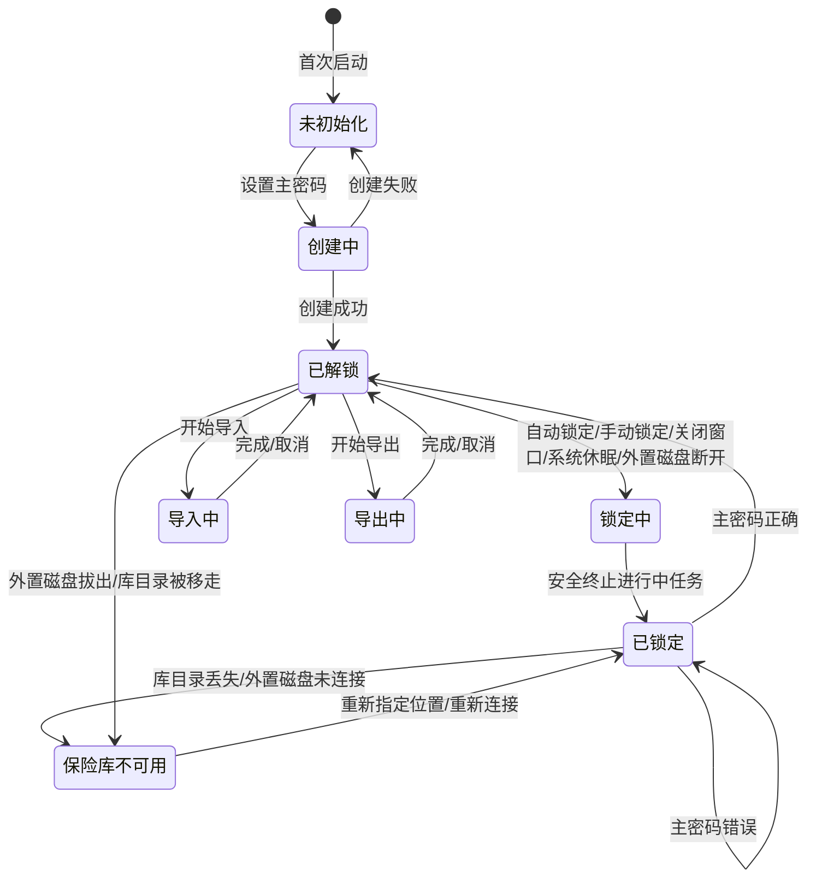
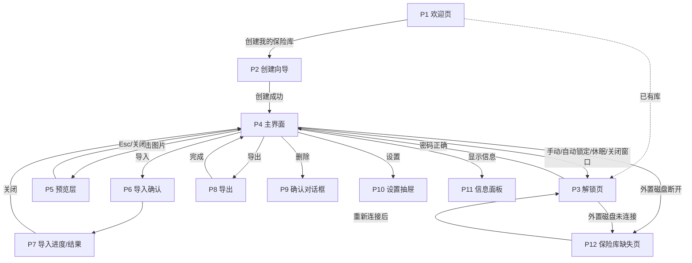

# Haven 产品需求分析报告

> 版本：**v0.2**（需求分析稿，基于 v0.1 定向修订）
> 修订日期：2026-11-20
> 产品形态：本地桌面应用（Tauri + Vue 3 + Rust + Naive UI + SQLite）
> 文档范围：**只描述产品行为与业务规则，不涉及技术架构、加密算法选型、数据库设计与接口设计。**
> 本次修订依据：第 12 章 Q-01 ~ Q-15 的产品决策；修改明细见第 13 章；冲突检查见第 14 章；范围变化见第 15 章。

---

## 0. 阅读约定

### 0.1 标记说明

| 标记 | 含义 |
| --- | --- |
| `FR-xx` | MVP 必须实现的功能需求 |
| `P1-xx` | 后续版本功能，MVP 不实现 |
| `[TBD]` | 信息缺失，需要产品决策或留待技术设计阶段确定 |
| `[假设]` | 为推进文档而做的合理默认判断，需用户确认 |
| `[非目标]` | 明确不做的事情，用于防止范围蔓延 |
| `〔v0.2〕` | 表示该段落在 v0.2 中被修订或新增 |

> v0.1 中带 `[假设]` 的条目，凡已由 Q-01 ~ Q-15 覆盖的，在 v0.2 中一律转为确定决策，不再以假设形式存在。剩余 `[TBD]` 集中在第 12.2 节。

### 0.2 关键术语（全文统一）

| 术语 | 定义 |
| --- | --- |
| 保险库（Vault） | 一个受主密码保护的本地加密容器，是所有文件的唯一存放位置。MVP 中整个应用只有一个保险库，名称固定为「我的保险库」。 |
| 主密码 | 用户设置的、用于解锁保险库的唯一口令。不存储明文，不可找回。 |
| 文件条目 | 保险库中一条被加密保存的文件记录，拥有独立的显示名、类型、大小、导入时间。 |
| 解锁 / 锁定 | 解锁 = 主密码校验通过、文件内容可被应用读取；锁定 = 应用不再持有可解密的能力，界面不展示任何文件内容。 |
| 回收站 | 被删除但仍占用空间的文件条目的暂存区，可恢复或彻底删除。 |
| 安全终止〔v0.2〕 | 锁定或退出时对进行中任务的统一处理方式：停止任务、保留已完成结果、丢弃并清理未完成的中间数据。定义见 FR-07。 |
| 应用自建临时数据〔v0.2〕 | 由 Haven 自身创建并可自行删除的文件，仅包括导入中间数据、缩略图缓存、导出中间文件。不含操作系统管理的交换空间、崩溃转储、系统日志、系统备份。 |

### 0.3 全局约束（贯穿所有需求）

| 编号 | 约束 |
| --- | --- |
| C-1 | 离线优先：应用在**完全断网**环境下必须 100% 可用，无任何降级。 |
| C-2 | 无云端：不引入任何账号体系、云同步、远程存储、在线 AI 服务。 |
| C-3 | 无网络请求：应用运行期间不发起任何外部网络连接（含遥测、崩溃上报、更新检查、字体/图标 CDN）。 |
| C-4 | 数据主权：所有数据仅存在于用户本机磁盘，用户可随时整体复制、迁移、删除。 |
| C-5 | 单用户单机：不做账号、不做多用户权限，权限边界 = 操作系统账户边界。 |
| C-6〔v0.2〕 | 平台范围：MVP 仅支持 macOS（Q-10）。所有异常、快捷键、路径规则按 macOS 定义。 |
| C-7〔v0.2〕 | 语言范围：MVP 仅中文界面（Q-11），非中文系统环境同样显示中文。 |
| C-8〔v0.2〕 | 存储位置：保险库可位于本机磁盘或外置磁盘（Q-12）。外置磁盘断开时必须停止全部读写并进入保险库不可用状态，不得自动创建新保险库。 |
| C-9〔v0.2〕 | 安全表述底线：不得声称应用能清除操作系统层面的所有明文残留；不得把普通文件删除描述为安全擦除。详见第 9 章。 |

---

## 1. 产品定位与目标用户

### 1.1 一句话定位

Haven 是一个「本机上的私人抽屉」：把不想被随意翻看的照片和文件，放进一个只有自己密码能打开的加密空间，平时安静、打开顺手、不用时自动上锁。

### 1.2 产品要解决的问题

| 现状问题 | 用户的实际感受 |
| --- | --- |
| 私人照片、证件扫描件、财务文件以明文散落在桌面、下载目录、相册中 | 电脑借人、送修、被家人打开时，内容一览无余 |
| 已有加密工具（压缩包加密、磁盘加密镜像）操作繁琐 | 每次存取都要"压缩—加密—改后缀—再解压"，无法当日常工具用 |
| 隐私工具界面偏"工程师向"或偏"监控向" | 使用过程有压力感，不想天天打开 |

### 1.3 目标用户

**核心用户（MVP 唯一服务对象）**

- 单机个人用户，拥有一台属于自己的 Mac。
- 平台范围：**MVP 仅 macOS**（Q-10），Windows 与 Linux 不在本版本范围内。〔v0.2：v0.1 此处为 `[TBD]`，现已确定〕
- 有 10~2000 个量级的私人文件需要保护，以照片、截图、证件扫描件、PDF 为主。
- 不具备加密技术知识，**不会**判断算法强度、密钥管理、威胁模型。
- 使用动机是"防止被随手看到"，而非对抗专业取证。

**典型画像（[假设]，需用户研究验证）**

| 维度 | 描述 |
| --- | --- |
| 年龄 | 22~45 |
| 技术水平 | 普通电脑使用者，能拖拽文件、能记住一个密码 |
| 使用频次 | 每周 1~5 次，单次 1~10 分钟 |
| 关键心理 | 想要"安全感"，但不想要"仪式感" |

**非目标用户（明确不服务）**

- 企业团队、需要多人共享密钥的场景 `[非目标]`
- 需要合规审计、司法取证、密钥托管的场景 `[非目标]`
- 需要跨设备实时同步的用户 `[非目标]`
- 需要隐藏"存在加密行为"本身的用户（本产品不提供可否认性）`[非目标]`

### 1.4 产品边界

**做：** 加密存储、快速浏览、快速取用、自动上锁、可随时导出。

**不做：** 云同步、账号、分享链接、在线协作、文件编辑、图片修图、密码管理器、系统级全盘加密。

> 与系统能力的分工：Haven 保护的是"应用内这份副本"，不负责保护用户从 Haven 导出到桌面的文件，也不替代 FileVault 类的全盘加密。这一点必须在产品内被用户理解，而不是靠文档。

### 1.5 与"信任"有关的定位判断

用户把最私密的东西交给一个看不懂内部原理的软件，产品必须用**可感知的行为**建立信任，而不是用技术名词。具体要求见第 9 章。

---

## 2. 核心使用场景

### 场景 A：收纳（最高频）

小林从手机同步了 40 张身份证、护照、体检报告照片到电脑，散落在"下载"文件夹。她把它们全选拖进 Haven，Haven 复制并加密保存。**原件仍留在下载目录**（Haven 不会移动或删除原件），她自己决定何时在系统文件管理器中清理这些原件。〔v0.2：对齐 Q-01〕

- 触发点：产生了新的私密文件
- 完成判据：文件已进入保险库，界面可见

### 场景 B：取用（次高频）

需要给房东发一张身份证照片。小林打开 Haven，输入密码，找到图片，右键导出到桌面，发送后自行删除桌面副本，关闭窗口（进程退出，等同锁定）。

- 完成判据：文件出现在用户指定目录，且用户清楚"该副本已不受保护"

### 场景 C：随手查看

夜深时想翻一下自己的旧照片，但不想让这些照片出现在系统相册里。打开 Haven → 解锁 → 网格浏览 → 全屏查看 → 关闭窗口（立即退出进程并锁定）。

### 场景 D：误删恢复

整理时误删了一个文件夹里的 12 张图。进入回收站，全选恢复，回到原分类。

### 场景 E：换机 / 备份

换新电脑前，**完全退出 Haven 后**，把整个保险库目录复制到移动硬盘；新电脑安装 Haven 后指向该目录，用同一个主密码解锁。〔v0.2：对齐 DP-06〕

### 场景 F：别人用我的电脑

朋友借用电脑。Haven 处于锁定状态，双击图标只看到密码输入框，看不到任何文件名、缩略图或数量。

### 场景 G：保险库放在 U 盘〔v0.2 新增〕

把保险库放在外置磁盘上，插上时正常解锁使用；拔出后应用立即停止读写并锁定，重新插上并解锁后才能继续。

---

## 3. 用户使用流程

### 3.1 首次使用（一次性）

```
启动应用
  → 欢迎页（说明：本地存储 / 无云端 / 忘记密码无法找回）
  → 点击「创建我的保险库」
  → 设置主密码（输入 + 确认 + 强度提示 + 显示/隐藏切换）
  → 勾选「我已了解：忘记主密码将无法恢复任何文件」
  → 点击「创建」
  → 创建进度（加密初始化）
  → 进入主界面（已解锁、空状态）
```

**说明〔v0.2〕**：创建流程不提供保险库命名输入，库名固定为「我的保险库」（Q-15）。

**异常分支**

- 两次密码不一致 → 就地提示，停留在当前步骤
- 密码长度不足 12 个字符 → 就地提示，不可继续
- 创建过程中磁盘不可写 / 空间不足 / 外置磁盘被拔出 → 创建失败，回到密码步骤，**不留下半成品保险库**

### 3.2 日常启动与锁定

```
启动应用
  → 若已存在保险库 → 解锁页（显示「我的保险库」+ 密码框，不显示任何文件信息）
  → 输入正确密码 → 主界面
  → 使用中（无操作计时，计时不因导入/导出/预览而暂停）
  → 达到自动锁定时间 / 系统休眠唤醒 / 点击锁定 / 关闭窗口 / 外置磁盘断开
  → 安全终止进行中的任务（若有）
  → 回到解锁页（关闭窗口则退出进程）
```

### 3.3 导入流程〔v0.2：删除"源文件是否保留"选项〕

```
主界面点击「导入」或拖拽文件到窗口
  → 选择文件（系统文件选择器，支持多选）或拖入文件/文件夹
  → 导入前确认面板（数量、总大小、同名处理方式、固定说明"原件将保留在原位置"）
  → 开始导入（逐条进度 + 可取消）
  → 完成汇总（成功 N 个 / 失败 M 个 / 跳过 K 个）
  → 列表刷新，新文件置顶高亮
```

### 3.4 查看流程

```
主界面网格 → 点击缩略图 → 全屏预览
  → 左右切换 / 缩放
  → Esc 或关闭 → 回到网格（保持滚动位置与选中状态）
```

### 3.5 导出（取用）流程

```
选中 1 个或多个文件 → 点击「导出」
  → 选择目标文件夹
  → 导出进度
  → 完成提示：「已导出到 <路径>。导出后的文件不再受 Haven 保护。」
  → 提供「在访达中显示」按钮
```

### 3.6 删除与恢复流程

```
选中文件 → 删除 → 确认对话框 → 移入回收站
回收站 → 选中 → 恢复（回到原分类）/ 彻底删除（二次确认，不可恢复）/ 清空回收站
```

### 3.7 完整生命周期状态机



---

## 4. 核心功能模块总览

| 模块 | 目标 | 版本 | 需求编号 |
| --- | --- | --- | --- |
| M1 保险库与解锁 | 创建、解锁、锁定、自动锁定 | MVP | FR-01 ~ FR-09 |
| M2 文件导入 | 把外部文件安全收进保险库 | MVP | FR-10 ~ FR-18 |
| M3 浏览与检索 | 找到目标文件 | MVP | FR-19 ~ FR-25 |
| M4 预览 | 不落地明文地查看内容 | MVP | FR-26 ~ FR-31 |
| M5 文件管理 | 重命名、删除、回收站、恢复 | MVP | FR-32 ~ FR-38 |
| M6 导出 | 把文件取回到系统目录 | MVP | FR-39 ~ FR-43 |
| M7 设置 | 锁定策略、外观、库信息 | MVP | FR-44 ~ FR-49 |
| M8 安全与隐私 | 贯穿性约束 | MVP | SEC-01 ~ SEC-20、DP-01 ~ DP-07 |
| M9 多库 | 多个独立保险库 | P1 | P1-01 |
| M10 组织能力 | 相册、标签、文件夹层级 | P1 | P1-02 ~ P1-04 |
| M11 更多预览格式 | PDF、视频、文本 | P1 | P1-05 |
| M12 生物识别解锁 | Touch ID | P1 | P1-06 |
| M13 备份与迁移 | 引导式备份、换机迁移 | P1 | P1-07 |
| M14 主密码变更 | 修改主密码 | P1 | P1-08 |

> 模块依赖关系（用于后续架构拆分）：M2/M3/M4/M5/M6 全部依赖 M1 的「已解锁」状态；M6 是唯一的"明文出口"，因此安全约束最重。

---

## 5. MVP 范围

### 5.1 MVP 定义

**MVP = 一条能完整跑通的闭环旅程**：

> 创建一个保险库 → 把文件导入进去 → 能浏览和查看 → 能取出来 → 能删除和恢复 → 关掉后别人打不开。

任何不服务于这条闭环、或不能支撑其异常恢复的功能，都不进 MVP。

### 5.2 MVP 功能清单（做 / 不做）〔v0.2 更新〕

| 能力 | MVP | 说明 |
| --- | --- | --- |
| 创建保险库 + 设置主密码 | ✅ | 单一保险库，名称固定为「我的保险库」 |
| 解锁 / 锁定 / 自动锁定 / 休眠强制锁定 | ✅ | 长任务不阻止锁定，见 FR-07 |
| 导入文件（多选、拖拽、文件夹） | ✅ | 文件夹递归导入时扁平化 |
| 导入后**始终保留源文件** | ✅ | 不提供自动删除源文件选项（Q-01） |
| 同名冲突处理 | ✅ | 自动重命名，不做覆盖 |
| 网格 / 列表浏览 | ✅ | |
| 图片缩略图 | ✅ | 加密保存 |
| 搜索（按文件名）、类型筛选、排序 | ✅ | |
| 图片全屏预览 | ✅ | 仅图片（Q-07） |
| 重命名、删除、回收站、恢复、彻底删除 | ✅ | 回收站不自动清理（Q-13） |
| 导出单个 / 批量 | ✅ | 唯一明文出口 |
| 本机磁盘 + 外置磁盘作为库位置 | ✅ | 拔出即停止读写并锁定（Q-12） |
| 设置：自动锁定时间、主题、库位置、关于 | ✅ | |
| 空状态、错误提示、进度与取消 | ✅ | |
| 平台：仅 macOS | ✅ | Q-10 |
| 语言：仅中文 | ✅ | Q-11 |
| 应用内删除整个保险库 | ❌ | Q-08：不提供，用户通过系统文件管理器管理 |
| 自定义保险库名称 | ❌ | Q-15 |
| 导入时删除/移动源文件 | ❌ | Q-01 |
| 内容去重 | ❌ | Q-06 |
| 多保险库 | ❌ | P1 |
| 相册 / 标签 / 文件夹层级 | ❌ | P1 |
| PDF / 视频 / 文本预览 | ❌ | P1 |
| Touch ID 解锁 | ❌ | P1 |
| 修改主密码 | ❌ | P1（涉及全库重新加密，风险高） |
| 密码找回 / 密保问题 | ❌ | `[非目标]` 与"不可找回"的安全承诺冲突 |
| 阻止截图 / 录屏 | ❌ | Q-09 |
| 云同步 / 账号 / 分享 | ❌ | `[非目标]` |
| 文件编辑、图片编辑 | ❌ | `[非目标]` |
| 密码管理器、剪贴板历史 | ❌ | `[非目标]` |
| 自动备份、备份提醒 | ❌ | P1 |
| 拖拽文件到外部应用打开 | ❌ | P1（会产生明文落地，需专门设计） |
| Windows / Linux 支持 | ❌ | Q-10 |

### 5.3 MVP 验收口径〔v0.2 增补第 7、8 条〕

MVP 可判定完成，当且仅当以下 8 条全部成立：

1. 断网环境下，从创建库到导出文件的完整流程无任何阻塞、无任何报错。
2. 在系统文件管理器中查看保险库目录，**看不到任何原始文件名、缩略图或可打开的明文文件**。
3. 锁定状态下（含刚启动未解锁），界面上不出现任何文件名、缩略图、文件数量。
4. 一次性导入 200 个文件（含 3 个同名文件、1 个无权限文件），结果为 199 成功 + 1 失败并给出可读原因，应用不崩溃。
5. 强制结束进程后重启，已完成导入的文件全部完好；未完成的导入不产生"幽灵条目"。
6. 导出后的文件可正常打开，且导出提示明确告知"该副本已不受保护"。
7. 〔v0.2〕外置磁盘上的保险库在使用中被拔出：应用立即停止读写、锁定并显示保险库不可用；不写入任何数据、不自动创建新库；重新连接后必须重新输入主密码。
8. 〔v0.2〕关闭主窗口后，应用进程完全退出（活动监视器中无残留进程），且再次启动时处于锁定状态。

---

## 6. 功能模块详细需求

> 每个需求按「触发 → 规则 → 结果 → 状态变化」描述，可直接转为开发任务与验收用例。

### 6.1 M1 保险库与解锁

#### FR-01 首次启动欢迎页

- **触发**：应用启动且本机不存在保险库。
- **内容**：产品名、一句话说明、三条核心承诺（数据只在本机 / 无需联网 / 忘记密码无法找回）、主按钮「创建我的保险库」。
- **规则**：不展示任何技术名词（如"加密算法""密钥派生"）；不提供"稍后再说"导致的无库主界面。
- **结果**：点击主按钮进入 FR-02。

#### FR-02 设置主密码〔v0.2 全文替换〕

- **触发**：欢迎页点击创建。
- **输入项**：主密码、确认密码、显示/隐藏切换、密码强度提示。
- **规则**：
  - 支持长密码与密码短语（passphrase），例如由多个单词与空格组成的句子。
  - 长度下限 **12 个字符**；空格与符号均计入长度并有效。
  - **不强制**任何字符组合规则（不要求大小写混合、不要求数字或符号），也**不禁用**任何组合。
  - 不做"弱密码硬拦截"，只在低于建议强度时提示，不阻止创建。
  - 强度提示分为「偏弱 / 一般 / 较强」三档，并给出可执行建议（增加长度、增加单词数、避免使用生日或单一人名）。
  - 实时校验：两次输入不一致时禁用「创建」。
  - 密码按用户输入使用，**不得静默修改**用户输入。空格处理与 Unicode 归一化的具体规则留待技术设计阶段确定；规则一旦确定，必须在密码输入框下方以可见文案说明（例如「密码区分大小写，空格有效」）。
  - 密码不写入日志、不写入剪贴板、不做自动填充、不显示任何派生信息。
- **状态变化**：通过校验并完成 FR-03 后进入创建。
- **异常**：长度不足 12 或两次不一致 → 就地提示，按钮禁用。
- **理由**：长密码短语比强制组合更符合真实用户记忆习惯，且能获得更高熵；具体实现规则不在此阶段锁定（Q-02）。

#### FR-03 不可找回确认

- **触发**：密码步骤通过。
- **规则**：必须勾选「我已了解：忘记主密码将无法恢复任何文件，Haven 不提供找回方式」才能点击「创建」。勾选状态不默认选中，不记忆。
- **理由**：这是全产品唯一不可逆的承诺，必须显式取得用户确认。

#### FR-04 创建保险库

- **触发**：确认后点击「创建」。
- **过程**：显示不确定进度（非百分比），文案「正在创建保险库…」；期间关闭窗口需二次确认（创建属于秒级、不可中断的初始化，不属于 FR-07 所说的长任务）。
- **结果**：创建成功后直接进入已解锁的主界面（空状态）。
- **失败处理**：磁盘不可写、空间不足、目标目录被占用、外置磁盘在创建中被拔出 → 提示具体原因 + 「重试」「返回」；失败后磁盘上不留半成品目录。
- **状态变化**：未初始化 → 已解锁。

#### FR-05 解锁

- **触发**：应用启动时已存在保险库；或处于锁定状态。
- **界面**：显示固定库名「我的保险库」、密码输入框、「解锁」按钮。**不展示**文件数量、缩略图、最近文件。
- **规则**：
  - 输入正确 → 进入主界面，焦点落在搜索框或内容区。
  - 输入错误 → 输入框下提示「密码不正确」，清空输入框，光标回到密码框。
  - 不做错误次数锁定或递增延迟（Q-03）。理由：离线场景下次数限制无法阻止本地反复尝试，**不能作为暴力破解的主要防护**；真正的防护来自密码长度/熵与派生计算成本，后者由技术设计阶段确定（SEC-18）。
  - 解锁过程超过 2 秒时显示「正在解锁…」。
- **状态变化**：已锁定 → 已解锁。

#### FR-06 手动锁定〔v0.2 修订〕

- **触发**：主界面点击「锁定」（或快捷键 `⌘L`）。
- **规则**：
  - 立即关闭所有预览层；清空界面上的文件内容；回到解锁页。
  - 若存在进行中的导入/导出，**不弹确认**，直接按 FR-07 的「锁定时任务处理」统一规则执行安全终止。
  - 手动锁定与自动锁定、休眠、退出、外置磁盘断开使用**完全相同**的终止语义，不允许某一入口有例外。

#### FR-07 自动锁定〔v0.2 全文替换〕

- **触发**：已解锁状态下无鼠标/键盘操作达到设定时长。
- **规则**：
  - 默认 5 分钟；可选 1 / 5 / 15 / 30 分钟 / 从不。
  - **长任务不能无限期阻止锁定**：导入、导出、预览都不暂停计时，达到时长即锁定。
  - 锁定前 10 秒不做弹窗倒计时，直接锁定（避免打断，也避免被用来延长会话）。
  - **锁定时任务处理（统一规则，适用于手动锁定、自动锁定、系统休眠、关闭窗口、外置磁盘断开）**：
    1. 立即停止进行中的导入/导出。
    2. 已完成并通过完整性校验的文件条目**保留**在库中。
    3. 未完成的中间数据（已接收但未落库的部分、应用自建临时文件）**丢弃并清理**，不进入列表。
    4. 界面回到解锁页（关闭窗口则退出进程），不保留任何文件内容。
    5. 解锁后（或下次启动后）以一次性提示告知：已完成 N 个、被中断 M 个。
  - **导出的特别说明**：导出是明文出口。被中断时，已经写入目标目录的文件**保留在原处**，Haven 不擅自删除用户目标目录中的文件；解锁后必须提示用户「有 N 个文件已导出到 <路径>，请确认是否需要清理」。
  - 选择「从不」时显示风险提示，但允许设置。
- **结果**：回到解锁页（或退出）。
- **一致性要求**：导入、导出、休眠、自动锁定、手动锁定、关闭窗口、外置磁盘断开，七种入口必须产生一致的可观察行为（见第 14 章检查项 1）。

#### FR-08 强制锁定场景〔v0.2 修订〕

| 场景 | 行为 |
| --- | --- |
| 系统休眠 / 睡眠 / 合盖 | **立即锁定，优先级高于任何进行中的任务**（先锁定，再处理任务终止），不可关闭该策略 |
| 关闭主窗口 | 立即退出应用进程（Q-05），退出前执行安全终止，见 FR-49 |
| 应用崩溃 / 被强制结束 | 重启后处于锁定状态；应用自建临时数据在下次启动时清理 |
| 切换系统用户 / 屏幕锁定 | 锁定 |
| 外置磁盘断开 | 立即停止全部读写 → 锁定 → 进入「保险库不可用」（FR-09） |

- **规则**：以上场景均不得询问"是否锁定"，安全方向由产品直接决定。

#### FR-09 保险库不可用〔v0.2 扩展〕

- **触发**：启动时找不到库目录；使用中库目录被删除、被移走；外置磁盘断开或未连接；所在磁盘不可读写。
- **规则**：
  - 显示独立页面「找不到你的保险库」，提供「重新连接 / 重试」「重新指定位置」两个动作。
  - **不得**在用户未确认的情况下自动创建新库覆盖原路径。
  - 外置磁盘场景下，页面需说明「保险库可能位于未连接的磁盘上」。
  - 恢复可用后必须回到锁定状态，重新输入主密码才能继续使用。
- **数据约束**：进入该状态期间，应用不得对库目录发起任何写入。

### 6.2 M2 文件导入

#### FR-10 导入入口

- **方式一**：主界面「导入文件」按钮 → 系统文件选择器（多选）。
- **方式二**：从系统文件管理器拖拽文件/文件夹到窗口（已解锁状态）。
- **方式三**：拖拽到 Dock 图标 —— MVP **不支持**（Q-10 平台收窄后不在范围内）。
- **锁定状态**：拖拽到锁定页应提示「请先解锁」，不接收内容。

#### FR-11 导入前确认〔v0.2 修订〕

- **展示**：文件总数、总大小、按类型分布（图片 N / 文档 N / 其他 N）。
- **固定说明（必须显示，不可关闭）**：「Haven 会复制一份加密副本到保险库，原文件保持在原位置，不会被移动或删除。」
- **选项**：
  - 同名文件处理：「自动重命名（推荐）」为默认且**唯一**选项。
  - **MVP 不提供任何"导入后删除源文件"或"移动源文件"的选项**（Q-01）。
- **长导入提示**：当文件总数 > 200 或总大小 > 2GB 时，显示提示：「导入过程中如达到自动锁定时间，导入会被安全中断（已完成部分保留）。可在设置中调整自动锁定时间。」〔v0.2 新增，用于缓解 FR-07 与长任务的体验冲突〕
- **规则**：总大小为 0 或全部不可读时禁用「开始导入」。
- **可折叠**：单次导入少于 5 个文件时，确认面板可折叠为一行摘要，但固定说明仍需在摘要中可见。

#### FR-12 文件夹导入

- **规则**：递归扫描子目录，**全部文件扁平化导入**，不保留目录结构（MVP 无文件夹概念）。
- **提示**：确认面板注明「将复制该文件夹内全部 X 个文件到保险库，不保留目录结构，原文件夹不变」。
- **排除**：跳过隐藏文件与系统文件（如 `.DS_Store`）；跳过符号链接以免循环。

#### FR-13 导入过程〔v0.2 修订〕

- **展示**：当前文件名（**MVP 直接显示真实文件名**，Q-14）、总进度条、已处理/总数、已用时间、取消按钮。
- **规则**：
  - 串行导入，单个失败不中断整体。
  - 点击「取消」→ 停止后续文件，已完成文件保留，清理未完成的中间数据，弹出汇总。
  - 导入期间允许继续浏览已有文件。
  - 导入期间**不得**阻止自动锁定；触发锁定即按 FR-07 统一规则安全终止，不弹确认。
  - 导入期间不允许修改自动锁定设置（避免"先导入再关锁定"的规避路径）。
- **状态变化**：已解锁 → 导入中 → 已解锁 / 已锁定。

#### FR-14 同名冲突

- **规则**：与库内已有文件同名时，自动重命名为 `原名 (1).扩展名`、`原名 (2).扩展名`，序号递增直到不冲突。
- **约束**：MVP **不提供覆盖**，避免误删数据。
- **结果**：汇总中列出「Y 个文件已自动重命名」。

#### FR-15 文件类型与大小

- **类型**：不限制扩展名，任何文件都可导入；分类仅用于浏览筛选（见 FR-20）。
- **单文件大小**：MVP 不设上限，但超过 1GB 时在确认面板提示「该文件较大，导入可能需要较长时间」。
- **非法文件名**：文件名含控制字符或长度超过系统限制时，导入后使用「未命名文件」+ 序号作为显示名，并在 FR-38 信息面板中可见原始名（仅本次会话内存中保留，见 DP-01）。

#### FR-16 导入完成汇总

- **展示**：成功 N / 失败 M / 跳过 K；失败项可展开查看「文件名 + 原因」。
- **原因文案**（面向用户，不暴露技术错误码）：文件不存在、没有读取权限、磁盘空间不足、文件正在被其他程序使用、目标磁盘已断开、其他错误。
- **结果**：列表自动刷新并滚动到新导入文件；新文件带 2 秒高亮。

#### FR-17 导入中断恢复〔v0.2 修订〕

- **触发**：导入过程中应用崩溃、断电、被强杀、触发锁定（手动/自动/休眠）、关闭窗口、外置磁盘被拔出。
- **规则**：
  - 已完成并通过校验的文件条目完整可用。
  - 未完成文件**不出现在列表**，不产生 0 字节或半截的残留条目。
  - 应用自建的导入中间数据在下次启动时清理，不留可识别内容。
  - 若检测到上次导入未完成，解锁后显示一次性 Toast「上次导入未完成，已完成的部分已保存」。
  - 因锁定或退出造成的重复文件风险：用户重新导入同一批文件时，按 FR-14 自动重命名，**不会**覆盖已有条目（Q-06：不做内容去重，因此可能出现重复条目，此行为在 MVP 中接受）。
- **约束**：不得把"中断恢复"描述为断点续传——MVP 不支持从断点继续，只能整体重新导入。

#### FR-18 重复导入同一文件

- **规则**：不做内容去重（Q-06，MVP 明确不支持）。同名文件按 FR-14 重命名，因此同一文件导入两次会得到两个条目。
- **理由**：内容去重需要对全库做比对，成本与感知收益不匹配 MVP；保留为 P1-09。

### 6.3 M3 浏览与检索

#### FR-19 主界面布局

```
┌──────────────────────────────────────────────────────┐
│ 我的保险库   [ 🔍 搜索文件名 ]      [导入] [锁定] [⚙] │
├──────────┬───────────────────────────────────────────┤
│ 全部文件 │  [视图切换] [排序 ▾]        [多选操作条] │
│ 图片     │                                           │
│ 文档     │         缩略图网格 / 文件列表              │
│ 其他     │                                           │
│ ──────   │                                           │
│ 回收站   │                                           │
└──────────┴───────────────────────────────────────────┘
```

〔v0.2：标题区固定显示「我的保险库」〕

#### FR-20 分类导航

| 分类 | 判定规则 |
| --- | --- |
| 全部文件 | 不在回收站的全部条目 |
| 图片 | `jpg/jpeg/png/gif/webp/heic/heif/bmp/tiff` |
| 文档 | `pdf/txt/md/doc/docx/xls/xlsx/ppt/pptx/csv` |
| 其他 | 其余扩展名及无扩展名文件 |
| 回收站 | 已删除条目 |

- **规则**：分类由扩展名推断，导入时计算一次并存储；重命名不改变分类。
- **未知扩展名**：归入「其他」，不报错。

#### FR-21 视图模式

- **网格（默认）**：固定缩略图尺寸，每组 4~6 列随窗口宽度自适应；非图片文件显示类型图标 + 文件名。
- **列表**：文件名、类型、大小、导入时间四列，可排序。
- **记忆**：视图模式、排序方式在本地记忆（属应用设置，不含文件信息）。

#### FR-22 排序

- 可选项：导入时间（默认，倒序）、文件名（升/降）、大小（升/降）。
- **并列规则**：数值相同时按导入时间倒序，保证顺序稳定。

#### FR-23 搜索

- **范围**：当前分类内的文件名模糊匹配（不区分大小写，支持中文）。
- **规则**：输入即搜，防抖后出结果；无结果时显示「没有找到包含「X」的文件」+ 清除按钮。
- **限制**：MVP 不搜索文件内容；不跨分类搜索（需先切回「全部文件」）。

#### FR-24 空状态

| 场景 | 文案与操作 |
| --- | --- |
| 库为空 | 「这里还没有文件」+ 「导入第一个文件」按钮 + 一句安抚文案（如"放轻松，这里只有你能打开"） |
| 某分类为空 | 「该分类下还没有文件」+ 「查看全部文件」链接 |
| 搜索无结果 | 见 FR-23 |
| 回收站为空 | 「回收站是空的」 |

#### FR-25 列表性能表现

- **要求**：1000 个条目时，滚动与切换分类不出现明显卡顿（主观标准：无超过 300ms 的白屏）。
- **缩略图**：只对可视区域及临近区域加载；滚动中出现占位灰块而非空白跳动。

### 6.4 M4 预览

#### FR-26 图片预览

- **触发**：网格中点击图片缩略图，或列表双击。
- **行为**：全屏预览层，深色背景，图片按比例完整显示（不裁切）。
- **支持格式**：`jpg/jpeg/png/gif/webp/heic/heif/bmp/tiff`；GIF 播放动图；HEIC/HEIF 需能正确解码（若无法解码，按 FR-29 处理）。
- **范围**：MVP **仅支持图片预览**（Q-07），不含 PDF、视频、文本、Office 文档。

#### FR-27 预览交互

| 操作 | 行为 |
| --- | --- |
| `←` / `→` 或点击左右区域 | 切换到当前列表中的上一张/下一张 |
| 滚轮 / 触控板捏合 | 以指针位置为中心缩放 |
| 双击 | 在「适应窗口」与「100%」之间切换 |
| 拖动 | 放大状态下平移 |
| `Esc` | 关闭预览 |

- **顺序**：预览按当前分类 + 当前排序顺序切换，不跨分类。
- **边界**：第一张再按左键无动作（不循环），最后一张同理；按钮置灰。

#### FR-28 预览信息

- 顶部或底部浮层显示：文件名、大小、导入时间。
- 不显示原始来源路径（隐私考虑，见 DP-01）。

#### FR-29 无法预览

- **规则**：图片损坏、格式不被支持（如 `heic` 解码失败）、文件为 0 字节 → 显示占位图标 + 「无法预览此文件」+ 「导出后查看」按钮。
- **不得**：静默显示空白。

#### FR-30 非图片文件的预览

- **MVP**：不内置预览。点击非图片文件 → 显示信息面板（FR-38）+ 「导出后查看」按钮 + 说明「为避免在磁盘留下未加密副本，Haven 不在此打开该文件」。
- **理由**：用系统程序打开必须先落地明文，与产品安全承诺冲突，需专门设计后再做（P1-05、P1-10）。

#### FR-31 预览的隐私行为

- 预览内容不写入磁盘（无应用自建的明文缓存或临时文件，见 SEC-09、SEC-16）。
- 锁定发生时立即关闭预览层（包括预览中触发自动锁定）。
- 预览期间不修改文件（只读）。

### 6.5 M5 文件管理

#### FR-32 重命名

- **触发**：右键菜单 / 选中后操作条「重命名」。
- **规则**：默认选中主文件名、保留扩展名；不允许为空；长度上限 100 字符；不允许 `/` 等系统非法字符。
- **冲突**：与库内其他文件同名时提示「已存在同名文件」，需改名后才能保存。
- **结果**：列表即时更新，并按当前排序重新定位。

#### FR-33 删除到回收站（延期）

- **触发**：选中 1~N 个文件 → 删除（`Delete` 或右键菜单）。
- **规则**：弹出确认「将 N 个文件移入回收站？」；确认后移入回收站，文件仍占用空间。
- **撤销**：删除后 Toast 提供 5 秒「撤销」，撤回则恢复到原分类。
- **表述约束**：不得表述为"已从磁盘删除"或"已安全擦除"（SEC-17）。
- **阶段说明**：第五阶段 5.4 不实现本条；本阶段仅实现单文件直接删除，不开发回收站、批量删除或 5 秒撤销。本文其他回收站与撤销流程描述均属延期需求，不代表 5.4 已实现。

#### FR-34 回收站（延期）

- **展示**：与主列表一致的网格/列表，额外显示「删除时间」；顶部显示「共 N 个文件，占用 X MB」。
- **操作**：恢复、彻底删除、清空回收站。
- **规则**：回收站内容不参与自动清理（Q-13），长期占用空间由用户自行判断；锁定时同样不可见。

#### FR-35 恢复（延期）

- **规则**：恢复到原分类（不保留"原位置"，MVP 无文件夹概念）；若同名文件已存在，自动重命名。

#### FR-36 彻底删除

- **触发**：回收站内删除 / 清空。
- **规则**：明确二次确认，文案必须写明「该文件将从 Haven 中移除，无法通过 Haven 恢复」；确认后条目从列表移除，空间释放。
- **表述约束**：**不得**写成"永久抹除""安全擦除""无法被任何工具恢复"（SEC-17）。
- **不可逆**：不提供撤销（指无法通过 Haven 恢复，不代表操作系统层面无法恢复）。
- **5.4 适用方式**：本阶段将相同的确认文案、不可逆与表述约束用于单文件直接删除；回收站内删除与清空触发路径随 FR-33～FR-35 延期。

#### FR-37 多选

- **规则**：`⌘` 点选、`Shift` 连选、`⌘A` 全选当前列表；多选后顶部出现操作条（导出 / 删除 / 取消选择）。
- **限制**：重命名仅支持单选。

#### FR-38 详情面板

- **触发**：右键「显示信息」。
- **内容**：文件名、类型、大小、导入时间、所在分类、是否在回收站。
- **不含**：原始磁盘路径、任何派生密钥信息。

### 6.6 M6 导出

#### FR-39 导出入口

- 选中文件 → 「导出」→ 系统目录选择器。
- 支持单个与批量；批量时全部导出到同一目录。

#### FR-40 导出规则

- **文件名**：使用当前显示名。
- **冲突**：目标目录已存在同名文件 → 自动重命名为 `原名 (1).扩展名`，并在完成提示中说明。
- **约束**：MVP 不提供"覆盖"选项。

#### FR-41 导出进度与取消〔v0.2 修订〕

- 显示逐条进度与整体进度；可取消。
- **取消时**：已写入目标目录的文件保留，未完成的中间数据清理；汇总告知已导出 N 个、取消 M 个。
- **锁定/休眠/关闭窗口时**：按 FR-07 统一规则安全终止，已导出文件保留在目标目录，Haven 不删除用户目标目录中的文件。
- **解锁后的提示**：必须告知「有 N 个文件已导出到 <路径>，请确认是否需要清理」，避免用户忘记磁盘上存在明文副本。

#### FR-42 导出后的安全提示

- 完成提示必须包含：「已导出到 <路径>。导出的文件是未加密副本，不再受 Haven 保护。」
- 提供「在访达中显示」与「删除已导出文件」两个快捷操作。
- **理由**：这是产品最容易被误解的地方，必须显式提示而不是写在帮助文档里。

#### FR-43 导出失败

- 逐条失败不中断整体，汇总给出原因（目标无写入权限、磁盘空间不足、目标文件被占用、目标磁盘已断开）。
- 失败的文件在列表中不标记状态（避免引入复杂状态机），仅通过汇总告知。

### 6.7 M7 设置

| 编号 | 设置项 | 规则 |
| --- | --- | --- |
| FR-44 | 自动锁定时间 | 1 / 5（默认）/ 15 / 30 分钟 / 从不。选择「从不」时显示风险提示但允许。导入/导出进行中该设置不可修改（FR-13），其余情况修改后立即生效，不作用于已经结束的会话。 |
| FR-45 | 主题 | 浅色 / 深色 / 跟随系统，默认跟随系统。 |
| FR-46〔v0.2 修订〕 | 保险库位置 | 只读展示完整路径 + 存储类型（本机磁盘 / 外置磁盘）+ 「在访达中显示」。MVP 不支持应用内迁移；**不提供应用内删除或重建保险库的入口**（Q-08）。附一句说明：「如需删除保险库，请先完全退出 Haven，再在访达中删除整个保险库目录。该操作属于普通文件删除，不是安全擦除。」 |
| FR-47 | 立即锁定 | 等同 FR-06。 |
| FR-48 | 关于 | 版本号、许可信息、隐私声明入口（本地文本，不打开网页）。隐私声明需包含第 9.4 节的安全边界说明。 |
| FR-49〔v0.2 修订〕 | 退出应用 | 关闭主窗口 = 退出应用进程（Q-05）。退出前**不弹确认**，直接按 FR-07 统一规则安全终止进行中的任务；退出时清理应用自建临时数据，释放内存中的密钥。菜单栏「退出 Haven」与 `⌘Q` 行为一致。 |

- **不包含**：修改主密码（P1-08）、备份设置（见 DP-06）、删除保险库（Q-08）、自定义库名（Q-15）。

### 6.8 全局交互要求

- **快捷键**：`⌘L` 锁定、`⌘F` 聚焦搜索、`⌘I` 导入、`⌘Q` 退出、`Esc` 关闭当前层。
- **加载与反馈**：任何超过 300ms 的操作都需要可见的状态反馈（骨架屏、进度条、按钮 loading）。
- **错误提示**：使用「发生了什么 + 用户能做什么」的双段文案，禁止只显示错误码。
- **不可用状态**：按钮禁用时需可通过 hover 提示说明原因。

---

## 7. 页面结构与跳转关系

### 7.1 页面清单

| 编号 | 页面 | 类型 | 出现条件 |
| --- | --- | --- | --- |
| P1 | 欢迎页 | 全屏页 | 首次启动、无保险库 |
| P2 | 创建保险库向导 | 全屏页（3 步） | 从 P1 进入 |
| P3 | 解锁页 | 全屏页 | 已存在库且处于锁定态 |
| P4 | 主界面 | 全屏页 | 已解锁 |
| P5 | 预览层 | 全屏覆盖层（模态） | 从 P4 打开图片 |
| P6 | 导入确认面板 | 对话框 | 从 P4 触发导入 |
| P7 | 导入进度 / 结果 | 对话框 | 确认后 |
| P8 | 导出目录选择与进度 | 系统对话框 + 应用内进度 | 从 P4 多选后 |
| P9 | 确认对话框（删除/彻底删除/清空） | 对话框 | 破坏性操作前 |
| P10 | 设置抽屉 | 侧边抽屉 | 从 P4 顶部齿轮 |
| P11 | 文件信息面板 | 侧边抽屉 | 右键「显示信息」 |
| P12 | 保险库缺失页 | 全屏页 | 启动时找不到库、外置磁盘断开 |

### 7.2 跳转关系



### 7.3 页面关系约束

| 约束 | 说明 |
| --- | --- |
| 锁定即清屏 | 任何页面在锁定时都必须立即消失，不存在"锁定态下残留的预览层" |
| 单一入口 | 只有 P3 能进入 P4；不存在从 P2 之外绕过解锁进入 P4 的路径 |
| 中断即回到 P3 | 锁定导致任务中断时，必须先回到 P3，不允许停留在 P7/P8 的进度界面 |
| 破坏性操作必经 P9 | 删除、彻底删除、清空回收站，都必须经过确认对话框 |
| 不再有退出确认 | 关闭窗口与 `⌘Q` 直接退出，不出现"是否退出"的确认层（Q-05）。唯一例外：保险库创建过程中关闭窗口需二次确认，且确认后不得留下半成品（FR-04） |
| 层级最深两层 | 全屏页 → 模态/抽屉，禁止三层嵌套弹窗（避免用户迷路） |

---

## 8. 异常场景与边界情况

### 8.1 解锁与保险库

| 场景 | 预期行为 | 用户可见反馈 | 数据后果 |
| --- | --- | --- | --- |
| 密码输错 | 停留解锁页 | 「密码不正确」，清空输入 | 无 |
| 连续多次输错（如 10 次） | 不锁定、不延迟（Q-03） | 仅重复提示；真正的防护是密码强度与派生成本（SEC-18） | 无 |
| 密码含全角字符 / 输入法未切换 | 按实际输入字符校验 | 提供「显示密码」以便用户自查 | 无 |
| 粘贴密码时带首尾空格 | 由技术设计阶段确定规则；确定后必须可见说明 | 输入框下方说明文案；不静默修改输入 | 无 |
| 保险库目录被删除 | 进入 P12 | 「找不到你的保险库」+ 重新指定入口 | 数据不可通过 Haven 访问；不自动重建 |
| 保险库目录被移动到别处 | 进入 P12，可重新指定位置 | 重新指定后需重新解锁 | 无 |
| 保险库文件被外部程序修改/损坏 | 解锁时校验失败 | 「保险库可能已损坏」+ 备份恢复指引，不覆盖原文件 | 只读，不写入 |
| 两个应用实例同时打开同一库 | 第二个实例拒绝解锁 | 「保险库正在被另一个 Haven 窗口使用」 | 无，避免写入冲突 |
| 解锁时磁盘只读（如只读介质） | 允许浏览与预览，禁止写入类操作 | 写入类按钮禁用并说明原因 | 无 |
| 〔v0.2〕外置磁盘未连接时启动 | 进入 P12 | 「保险库可能位于未连接的磁盘上」+ 重试 | 无 |
| 〔v0.2〕使用中拔出外置磁盘 | 立即停止全部读写 → 锁定 → P12 | 「存储设备已断开，已锁定」 | 不写入任何数据；不自动创建新库 |
| 〔v0.2〕重新连接外置磁盘 | 停在 P12，需用户点击重试并重新输入主密码 | 「已重新连接，请解锁」 | 无 |

### 8.2 导入

| 场景 | 预期行为 |
| --- | --- |
| 导入 0 个文件 | 不允许开始，提示「没有可导入的文件」 |
| 文件在导入过程中被其他程序删除 | 该条目标记为失败，原因「文件不存在」，继续后续 |
| 文件被其他程序占用 | 失败，原因「文件正在被其他程序使用」 |
| 无读取权限 | 失败，原因「没有读取权限」 |
| 磁盘空间不足 | 失败并**立即停止后续导入**（避免逐个失败浪费用户时间），提示所需/可用空间 |
| 文件夹中包含 10000 个文件 | 确认面板提示总量；导入进度以"已处理/总数"呈现，允许取消 |
| 文件名超长（>255 字节） | 显示名截断并加序号，导入成功 |
| 文件名含 emoji / 稀有字符 | 正常导入与展示；若字体缺失，显示占位方框但不报错 |
| 导入的是保险库自身目录 | 拒绝并提示「不能把保险库导入到自身」，避免无限递归 |
| 拖入的是快捷方式/符号链接 | 跳过并在汇总中说明 |
| 〔v0.2〕导入中手动锁定 | **立即安全终止并锁定，不询问**；已完成保留；解锁后一次性提示 |
| 〔v0.2〕导入中触发自动锁定 | 同上，计时不因导入暂停 |
| 〔v0.2〕导入中系统休眠 / 合盖 | **先锁定再终止**，唤醒后停留在解锁页并提示 |
| 〔v0.2〕导入中关闭窗口 / `⌘Q` | 安全终止后立即退出，不弹确认；下次启动提示 |
| 〔v0.2〕导入中应用崩溃 / 断电 | 按 FR-17：已完成保留、未完成丢弃、中间数据下次启动清理 |
| 〔v0.2〕导入中拔出外置磁盘 | 立即停止、锁定、进入 P12；提示受影响文件数 |
| 〔v0.2〕导入后源文件 | 始终保留在原位置，Haven 不做任何删除或移动 |

### 8.3 浏览与预览

| 场景 | 预期行为 |
| --- | --- |
| 库内 1000+ 文件 | 虚拟滚动，缩略图按需加载，滚动不白屏 |
| 缩略图生成失败（损坏图片） | 显示通用图片占位图标，不阻塞列表 |
| 预览第一张按左键 | 按钮置灰，无动作，不循环 |
| 〔5.4〕预览中删除当前文件 | 关闭预览，回到列表，Toast 提示已从 Haven 移除；原回收站流程延期 |
| 预览中文件被外部删除 | 同库内删除，提示文件已不存在 |
| 〔v0.2〕预览中触发自动锁定 | 立即关闭预览并锁定，不保留任何图像内容 |
| 超宽/超长图片（如 20000×300） | 按适应窗口显示，缩放不卡死 |
| GIF 动图 | 播放，锁定后立即停止 |
| 窗口极窄（<800px） | 侧栏收起为图标，网格列数减少，不出现横向滚动条 |

### 8.4 删除、导出与退出

| 场景 | 预期行为 |
| --- | --- |
| 〔延期，不属于 5.4〕删除后立即点撤销 | 5 秒内恢复成功；超过 5 秒无法撤销，按钮消失 |
| 〔延期〕清空回收站时磁盘繁忙 | 逐条删除，部分失败则保留失败条目并提示重试 |
| 〔延期〕回收站长期不清理 | 不自动清理（Q-13）；顶部持续显示占用空间 |
| 导出到无权限目录 | 整体失败并提示「没有写入权限，请选择其他位置」 |
| 导出时目标磁盘空间不足 | 停止导出，提示已成功 N 个、失败 M 个 |
| 导出时目标目录存在同名文件 | 自动重命名，完成提示中说明 |
| 〔v0.2〕导出中手动/自动锁定 | **立即安全终止导出**，不询问；已导出文件保留在目标目录；解锁后提示清理 |
| 〔v0.2〕导出中系统休眠 | 先锁定再终止；已导出文件保留 |
| 〔v0.2〕导出中关闭窗口 / `⌘Q` | 安全终止后立即退出，不弹确认；已导出文件保留 |
| 〔v0.2〕导出中目标磁盘被拔出 | 停止导出，汇总已成功/失败；已写入的文件可能不完整，提示用户校验 |
| 〔v0.2〕窗口关闭 | 立即退出进程并锁定；再次启动需输入主密码 |
| 〔v0.2〕在系统文件管理器中删除保险库目录 | 应用下次启动进入 P12；该行为是普通文件删除，产品不得描述为安全擦除 |

### 8.5 系统与平台

| 场景 | 预期行为 |
| --- | --- |
| 完全断网 | 无任何功能受影响，无任何网络错误提示 |
| 系统时间被修改 | 文件列表按导入时间排序可能异常，但不影响数据；不依赖系统时间做安全判断 |
| 屏幕缩放 150% / 200% | 布局不重叠、不截断 |
| 〔v0.2〕非中文系统语言 | 界面仍为中文（MVP 仅中文），不出现乱码 |
| 系统主题切换（浅色 ↔ 深色） | 实时跟随，不重启 |
| 〔v0.2〕macOS 版本差异 | 最低支持版本待定（Q-19）；低于最低版本时启动前给出明确提示 |
| 〔v0.2〕外置磁盘文件系统不支持所需能力 | 创建或导入失败，并提示更换磁盘或格式 |

---

## 9. 数据安全与隐私的产品要求

> 本章只写**产品级可验收的要求**，不指定算法、参数或存储实现。

### 9.1 硬性要求（违反即视为产品缺陷）

| 编号 | 要求 | 验收方式 |
| --- | --- | --- |
| SEC-01 | 锁定状态下，保险库目录内不存在可被常规应用程序（预览、文本编辑器、图片查看器）直接打开的文件明文 | 锁定后遍历库目录，逐个尝试用系统默认程序打开，均无法获得原始内容 |
| SEC-02 | 库目录内不出现明文文件名、明文目录结构、明文分类信息 | 在库目录内全文检索已知文件名片段，无命中 |
| SEC-03 | 库目录内不出现明文缩略图或可直接预览的图片文件 | 遍历库目录，无可识别图片 |
| SEC-04 | 锁定状态下界面不展现任何文件信息（文件名、数量、缩略图、分类计数） | 锁定后逐页检查 |
| SEC-05 | 主密码不以明文或其他可直接还原的形式持久化在库目录、应用配置、日志与缓存中 | 检索库目录与配置目录，无明文密码；**边界见 SEC-19** |
| SEC-06 | 运行期间不发起任何外部网络连接 | 断网可用 + 网络活动监控无对外请求 |
| SEC-07 | 无遥测、无崩溃上报、无自动更新联网 | 检查应用内无相关设置项与请求 |
| SEC-08 | 日志只含事件类型、错误码、时间戳；不含文件名、路径、密码、文件内容、库路径 | 触发各类操作后检查日志文件 |
| SEC-09 | 应用内预览不产生明文临时文件；应用自建的临时文件必须位于应用可控位置，并在锁定/退出/异常恢复时清理 | 预览前后对比系统临时目录与用户可见目录，无新增可读文件 |
| SEC-10 | 同一保险库不允许被两个进程同时写入 | 双开验证：第二个实例被拒绝 |
| SEC-16〔v0.2 新增〕 | **临时数据范围与生命周期**：应用自建临时数据仅限三类——导入中间数据、缩略图缓存、导出中间文件。三者均不得写入桌面、下载、文稿等用户可见目录；均需在任务完成、取消、锁定、退出时被清理，异常终止后于下次启动清理 | 逐一验证三类文件的创建位置与清理时机 |
| SEC-17〔v0.2 新增〕 | **删除语义与文案禁令**：移入回收站 = 应用内逻辑删除；彻底删除/清空回收站 = 从 Haven 中移除且无法通过 Haven 恢复。二者均**不得**表述为「安全擦除」「彻底从磁盘抹除」「无法被任何工具恢复」；统一使用「从 Haven 中移除，无法通过 Haven 恢复」 | 全文检索界面与帮助文案，无违规表述 |
| SEC-18〔v0.2 新增〕 | **密码防护方式**：不得以"错误次数限制"作为离线暴力的主要防护；防护依赖密码长度/熵与派生计算成本。具体派生算法与成本参数由技术设计阶段确定并记录在安全说明中 `[TBD]` | 安全说明中存在该项记录；产品界面未把次数限制宣传为防护手段 |
| SEC-19〔v0.2 新增〕 | **内存与系统级残留的边界**：锁定/退出时应用须尽力清除自身内存中的密钥与已解密内容（含预览缓冲、缩略图明文）。同时必须明确：应用**无法保证**清除操作系统管理的内存落盘数据（交换空间、崩溃转储、休眠镜像）以及文件系统日志、系统备份 | 锁定时无任何可通过应用界面恢复的明文；隐私声明中含该边界说明 |
| SEC-20〔v0.2 新增〕 | **备份规则**：手动备份必须在**应用完全退出后**复制整个保险库目录；应用内不提供"运行中备份"能力；备份文件与原库同样受主密码保护；删除旧备份不构成安全擦除 | 设置页说明完整；退出状态下复制的目录可正常解锁 |

### 9.2 用户知情要求

| 编号 | 要求 |
| --- | --- |
| SEC-11 | 创建库时必须显式确认「忘记密码无法找回」 |
| SEC-12 | 首次导入时需用一句话说明「文件在本机加密保存，不会上传到任何地方，原文件保持原样」 |
| SEC-13 | 每次导出后必须提示「导出的是未加密副本」 |
| SEC-14 | 设置中可查看「本应用不联网」的说明（本地文本页） |
| SEC-15 | 删除到回收站与彻底删除的文案必须区分「可通过 Haven 恢复」与「无法通过 Haven 恢复」。**不得**使用"已安全删除"等暗示物理抹除的措辞〔v0.2 补充〕 |

### 9.3 隐私细节决定

| 决策 | 内容 | 理由 |
| --- | --- | --- |
| DP-01 | 不持久化原始文件路径 | 原路径本身是隐私信息（如"离婚协议.pdf"的目录名），且对用户无长期价值 |
| DP-02 | 不记忆主密码、不提供"记住我" | 唯一防线就是密码，任何便利化的记忆都在削弱它 |
| DP-03 | 退出应用即锁定，不保留后台解密态 | 降低"忘记锁了"的风险；Q-05 关闭即退出进一步强化这一点 |
| DP-04 | 不做文件内容分析（MVP 无 AI、无内容识别） | 与离线承诺一致，也避免误判；Q-06 明确不做内容去重 |
| DP-05 | 不阻止系统截图与录屏（MVP，Q-09） | 系统级防护会改变窗口行为，需专门设计，见 Q-09 |
| DP-06〔v0.2 修订〕 | 备份 = 用户**完全退出应用后**，复制整个保险库目录。应用不提供应用内备份按钮，设置页给出步骤说明与"为什么必须退出"的解释 | 运行中复制可能得到不一致的副本，反而制造"备份失败但用户以为是好的"风险 |
| DP-07〔v0.2 新增〕 | 删除整个保险库只能通过系统文件管理器进行；产品必须说明这是普通文件删除，不是安全擦除 | 与 SEC-17 保持一致，避免用户误以为数据已被物理抹除 |
| DP-08〔v0.2 新增〕 | 导入始终复制，不移动、不删除源文件 | Q-01：产品不对用户的原文件做任何销毁性操作，把清理权交还用户 |

### 9.4 明确的安全边界（必须在产品内传达）

- Haven 保护的是**保险库内**的副本；导出后的副本、用户手动放在桌面的原件，均不受保护。
- Haven 不防御：已获得系统管理员权限的恶意程序、键盘记录器、屏幕录制、以及拿到运行中已解锁电脑的人。
- Haven 不提供可否认性：任何人都能看出"这台电脑上有一个 Haven 保险库"。
- 〔v0.2〕Haven **不能**保证清除操作系统层面的明文残留，包括交换空间、崩溃转储、休眠镜像、文件系统日志与系统备份（如 Time Machine）。这些数据由操作系统管理，不在应用控制范围内。
- 〔v0.2〕普通文件删除（包括在访达中删除保险库目录）**不等于**安全擦除；机械硬盘的物理残留、SSD 的磨损均衡与 TRIM 行为都不是应用能控制的。
- 〔v0.2〕应用自建临时数据可被应用清理；系统级数据不可。产品任何文案不得把两者混为一谈。

---

## 10. 后续可扩展功能

> 分级原则：P1 = 已在产品逻辑中预留位置、MVP 不做但明确规划；P2 = 方向合理但需要更多验证；不做 = 与产品定位冲突。

### 10.1 P1（下一版本候选）

| 编号 | 功能 | 为什么放后面 |
| --- | --- | --- |
| P1-01 | 多保险库（如「工作」「私人」） | 需要库切换、库列表、独立锁定状态，MVP 单库模型更干净 |
| P1-02 | 相册 / 自定义集合 | 需要组织模型设计，MVP 先用分类 + 搜索 |
| P1-03 | 标签 | 同上，且需要输入交互设计 |
| P1-04 | 文件夹层级（导入时保留结构） | 与"扁平化"的 MVP 假设直接冲突，需重新设计导入语义 |
| P1-05 | PDF / 文本 / 视频内置预览 | 视频解码与 PDF 渲染成本高；且需要解决"外部程序打开会落地明文"的问题 |
| P1-06 | Touch ID 解锁 | 生物识别只能作为"便利层"，不能替代主密码；需要设计失败回退 |
| P1-07 | 引导式备份与迁移（换机） | 需要处理"备份文件同样需要密码"的认知问题 |
| P1-08 | 修改主密码 | 涉及全库重新加密，失败风险高，需要一次性完成与回滚设计 |
| P1-09 | 内容去重（导入时识别重复文件） | Q-06 明确 MVP 不做；依赖全库内容比对，性能与体验需验证 |
| P1-10 | 拖拽文件到外部程序打开 | 会产生明文临时文件，需专门的安全设计 |
| P1-11 | 最近导入 / 最近查看 | 需要额外的元数据与"最近"语义定义 |
| P1-12 | 批量重命名规则 | 低频需求，MVP 手动重命名足够 |
| P1-13〔v0.2〕 | 可恢复的导入队列（长导入被锁定中断后可继续） | MVP 采用"中断即放弃、已完成保留"的简单语义；恢复队列需要额外的持久化状态与一致性设计 |
| P1-14〔v0.2〕 | 自定义保险库名称 | Q-15 明确 MVP 固定名称；后续需评估"名称本身泄露信息"的问题 |

### 10.2 P2（待验证）

- 保险库导入/导出为单个归档文件（便于搬运）
- 只读分享（导出加密包给他人，需对方输入口令）
- 自动备份到用户指定外置磁盘
- 文件版本历史（同一文件名保留历史副本）
- 库容量与健康度概览（占用、条目数、最后备份时间）
- 应用锁 + 系统锁联动（如屏幕锁定即锁定 Haven）
- Windows / Linux 平台支持
- 〔v0.2〕更多界面语言

### 10.3 明确不做

| 功能 | 原因 |
| --- | --- |
| 云同步、网盘对接 | 违背"数据完全由用户掌控"与离线优先 |
| 账号体系 / 多用户协作 | 引入服务端，破坏产品承诺 |
| 在线 AI 分类、人脸识别上云 | 与无网络请求冲突；本地模型为 P2 待验证 |
| 密码找回 / 密保问题 / 恢复码托管 | 与"忘记密码无法找回"的安全承诺冲突 |
| 内置文件编辑器 | 范围蔓延，破坏"安静的工具"定位 |
| 隐藏保险库的存在（可否认性） | 需要完全不同威胁模型，不在本产品定位 |
| 承诺"安全擦除""物理抹除" | 应用无法控制磁盘底层行为，任何此类承诺都是虚假承诺（SEC-17） |

---

## 11. 关键对象与状态定义（供架构设计对齐）

### 11.1 对象

| 对象 | 属性（产品级） | 说明 |
| --- | --- | --- |
| 保险库 | 名称（固定为「我的保险库」）、创建时间、条目数、占用空间、锁定状态、存储位置类型（本机/外置） | 全局唯一（MVP）〔v0.2：名称固定、增加位置类型〕 |
| 文件条目 | 显示名、扩展名、分类、大小、导入时间、状态（正常/回收站）、缩略图 | 不保存原始路径 |
| 应用设置 | 自动锁定时长、主题、视图模式、排序方式 | 不含任何文件内容 |

### 11.2 状态

| 对象 | 状态 | 可迁移到 |
| --- | --- | --- |
| 应用 | 未初始化 / 已锁定 / 已解锁 / 导入中 / 导出中 / 锁定中 / 保险库不可用 | 见 3.7 |
| 文件条目 | 正常 / 回收站 | 正常 ↔ 回收站（彻底删除为终态） |
| 缩略图 | 就绪 / 生成中 / 不可用 | — |
| 进行中任务〔v0.2〕 | 无 / 导入中 / 导出中 | 任一状态在锁定时 → 安全终止 → 无 |

### 11.3 分类判定规则（唯一来源）

```
图片 = jpg, jpeg, png, gif, webp, heic, heif, bmp, tiff
文档 = pdf, txt, md, doc, docx, xls, xlsx, ppt, pptx, csv
其他 = 其余（含无扩展名）
```

> 该规则只在导入时计算一次并持久化，避免不同位置重复判断导致不一致。

---

## 12. 已解决的决策与尚未解决的问题

### 12.1 已解决决策表（Q-01 ~ Q-15）

| 编号 | 问题 | v0.2 决策 | 影响的修订点 |
| --- | --- | --- | --- |
| Q-01 | 导入后源文件如何处理 | **始终保留源文件**，不提供任何自动删除/移动源文件的选项 | FR-11、FR-12、FR-13、3.3、场景 A、5.2、8.2、DP-08 |
| Q-02 | 主密码强度规则 | 支持长密码与密码短语；**不强制字符组合**；仅提供强度提示；**建议最低 12 个字符**；字符与空格的归一化规则留待技术设计阶段确定 | FR-02、3.1、8.1 |
| Q-03 | 是否依赖错误次数限制 | **不依赖**次数限制，不做递增延迟；派生算法与计算成本留待技术架构阶段确定 | FR-05、SEC-18、8.1 |
| Q-04 | 长任务能否阻止自动锁定 | **不能**。锁定时安全终止未完成任务，保留已完成结果，清理未完成中间数据；休眠优先锁定 | FR-06、FR-07、FR-08、FR-13、FR-17、FR-41、FR-49、11.2、8.2、8.4 |
| Q-05 | 关闭窗口的行为 | **关闭窗口即退出应用进程**，退出前安全终止任务，不弹确认 | FR-08、FR-49、7.3、8.4、DP-03 |
| Q-06 | 是否支持内容去重 | **MVP 不支持** | FR-18、P1-09、DP-04 |
| Q-07 | 非图片文件是否内置预览 | **MVP 只支持图片预览** | FR-26、FR-30、5.2 |
| Q-08 | 是否提供应用内删除整个保险库 | **不提供**；用户通过系统文件管理器管理库目录；明确该操作为普通删除，非安全擦除 | FR-46、SEC-17、DP-07、8.4、9.4 |
| Q-09 | 是否阻止截图/录屏 | **MVP 不阻止** | DP-05、5.2 |
| Q-10 | 支持平台 | **MVP 仅 macOS** | 1.3、C-6、5.2、8.5、FR-10 |
| Q-11 | 界面语言 | **MVP 仅中文** | C-7、5.2、8.5 |
| Q-12 | 是否支持外置磁盘 | **支持本机磁盘与外置磁盘**；断开时停止读写、锁定、进入保险库不可用；**不得自动创建新库** | C-8、FR-09、FR-46、8.1、SEC-10 |
| Q-13 | 回收站是否自动清理 | **不自动清理** | FR-34、8.4、5.2 |
| Q-14 | 导入时是否显示文件名 | **显示真实文件名** | FR-13、5.2 |
| Q-15 | 保险库名称 | **固定为「我的保险库」**，MVP 不支持自定义 | 0.2、3.1、FR-01、FR-05、FR-19、FR-46、P1-14 |

### 12.2 尚未解决的问题

| 编号 | 问题 | 影响 | 当前处理 |
| --- | --- | --- | --- |
| Q-16 | 长导入与自动锁定的体验冲突：5 分钟自动锁定 + 10 分钟导入 = 必然中断。是否需要"锁定前有限延长"或"可恢复导入"？ | 影响导入体验，但不影响安全 | MVP 保持"到点即中断"，已在 FR-11 增加事前提示；可恢复导入列为 P1-13 |
| Q-17 | 密码的首尾空格处理与 Unicode 归一化规则 | 可能导致"看起来一样的密码打不开" | `[TBD]` 技术设计阶段确定；确定后必须在输入框下方可见说明（FR-02） |
| Q-18 | 派生计算成本参数，以及由此带来的解锁耗时 | 影响安全强度与解锁体验 | `[TBD]` 技术设计阶段给出实测数据，再由产品确认可接受度 |
| Q-19 | macOS 最低支持版本 | 影响可用 API 与测试矩阵 | `[TBD]`，见 8.5 |
| Q-20 | 外置磁盘文件系统差异（exFAT / 只读介质 / 不支持权限）下的降级行为 | 影响创建与导入的失败文案与可用性 | 8.5 已定义"失败并提示"，具体判定规则待技术阶段细化 |
| Q-21 | 若保险库目录位于被系统同步的位置（如 iCloud 桌面同步、Time Machine），是否需要在产品内提示 | 加密数据可能被系统同步到云端，与"无云端"的用户预期冲突 | `[TBD]`；MVP 默认位置不在同步目录，但用户可自行指定位置 |
| Q-22 | 应用自建临时数据的具体位置与保留时长 | 影响 SEC-16 的可验收性 | `[TBD]` 技术设计阶段确定，产品侧只约束"不得在用户可见目录、必须可被清理" |

---

## 13. v0.2 修订记录

### 13.1 修订概览

| 项目 | 内容 |
| --- | --- |
| 版本 | v0.1 → v0.2 |
| 修订性质 | 基于 Q-01 ~ Q-15 产品决策的定向修订，不重构文档结构 |
| 章节结构 | 未改变（0~11 章保持原结构，新增 12.2 与第 13~15 章） |
| 需求编号 | FR-01 ~ FR-49、SEC-01 ~ SEC-15、DP-01 ~ DP-05、C-1 ~ C-5 全部保留；新增 SEC-16 ~ SEC-20、DP-06 ~ DP-08（DP-06 为改写）、C-6 ~ C-9、P1-13 ~ P1-14 |

### 13.2 逐条修改明细

| # | 位置 | v0.1 | v0.2 | 原因 | 影响 |
| --- | --- | --- | --- | --- | --- |
| 1 | FR-02 | 最低 8 位，不做组合强制 | 最低 12 个字符，支持密码短语，明确不强制组合，空格/Unicode 规则留待技术阶段 | Q-02 | 创建流程校验条件变化；需新增输入框说明文案 |
| 2 | FR-07 | 导入/导出进行中不锁定；锁定前 10 秒不弹窗 | 长任务不能阻止锁定；新增统一的"锁定时任务处理"五步规则；新增导出中断后的明文提示 | Q-04 | 导入/导出可能在任意时刻被中断；需实现中间数据清理与解锁后提示 |
| 3 | FR-08 | 关闭窗口 = 退出或最小化到托盘 `[TBD]` | 关闭窗口立即退出进程；休眠锁定优先级最高；新增外置磁盘断开 | Q-05、Q-12 | 去掉托盘分支；新增磁盘断开分支 |
| 4 | FR-11 | 含"导入成功后删除原文件"选项 | 删除该选项；固定说明原件保留；新增长导入时长提示 | Q-01、Q-04 | 导入确认面板少一个选项，多一条固定说明 |
| 5 | FR-13 | 文件名显示待定（原指向 FR-44） | 明确显示真实文件名；导入期间不得阻止自动锁定；导入期间禁止修改锁定设置 | Q-14、Q-04 | 交互细节确定；新增一个禁用态规则 |
| 6 | FR-17 | 仅覆盖崩溃/断电 | 扩展到锁定、退出、外置盘拔出；明确"不是断点续传" | Q-04、Q-12 | 恢复语义与文案更严格 |
| 7 | FR-41 | 导出锁定策略指向 FR-07 | 明确中断后已导出文件保留、解锁后提示清理 | Q-04 | 需要跨状态的一次性提示机制 |
| 8 | FR-46 | 只读展示路径 + 在访达中显示 | 增加存储类型；明确不提供应用内删除/重建；说明普通删除非安全擦除 | Q-08、Q-12 | 设置页多一段说明文案 |
| 9 | FR-49 | 退出前对进行中任务二次确认 | 不弹确认，直接安全终止后退出 | Q-04、Q-05 | 去掉退出确认对话框 |
| 10 | SEC-01 ~ SEC-05 | 表述范围较宽 | 明确限定"保险库目录内""常规应用程序""不持久化到库/配置/日志/缓存"；SEC-05 增加边界引用 | 注意 A、B | 验收方式更可执行，避免过度承诺 |
| 11 | SEC-06 ~ SEC-10 | 无范围限定 | 保持要求，SEC-09 明确"应用自建"与"操作系统管理"的边界 | 注意 B | 避免把系统交换空间算作应用责任 |
| 12 | SEC-16 ~ SEC-20 | 无 | 新增：临时数据范围与生命周期、删除语义与文案禁令、密码防护方式、内存与系统级残留边界、备份规则 | 注意 A/B/C/D/G | 新增 5 条可验收安全要求 |
| 13 | DP-06 | 备份 = 用户自行复制库目录 | 必须完全退出后复制整个目录；说明原因 | 注意 G | 设置页需提供步骤说明 |
| 14 | DP-07 / DP-08 | 无 | 新增删除库的表述约束；新增"导入始终复制、不动源文件" | 注意 C、Q-01 | 文案约束与流程约束 |
| 15 | 第 8 章 | 多处"先询问""二次确认""Windows 常见" | 统一为安全终止；移除 Windows 相关；新增外置盘、休眠、退出场景 | 决策一致性、Q-10 | 异常表新增 9 行、改写 6 行 |
| 16 | 第 12 章 | Q-01 ~ Q-15 全部为 `[TBD]`/`[假设]` | 全部转为已解决决策；新增 Q-16 ~ Q-22 | 本次输入 | 未决项从 15 项降为 7 项，且安全决策类未决项清零 |
| 17 | 附录 B | 旧速览 | 按新决策重写 | 一致性 | 速览与正文对齐 |
| 18 | 1.3 / 5.2 / 8.5 | 平台与语言为 `[TBD]` | macOS only / 中文 only | Q-10、Q-11 | 测试矩阵与文案量收敛 |

---

## 14. 需求冲突检查结果

### 14.1 逐项检查

| # | 检查项 | 涉及需求 | 结论 | 处理 |
| --- | --- | --- | --- | --- |
| 1 | 锁定行为在七个入口是否一致 | FR-06、FR-07、FR-08、FR-13、FR-41、FR-49、8.2、8.4 | ✅ 一致 | 全部统一为"立即安全终止 + 保留已完成 + 清理中间数据"，无任何入口询问确认 |
| 2 | 导入源文件处理是否一致 | FR-11、FR-12、3.3、场景 A、8.2、DP-08 | ✅ 一致 | 全文统一"始终复制、保留原件"，已删除 v0.1 中的删除选项 |
| 3 | 保险库名称是否一致 | 0.2、3.1、FR-01、FR-05、FR-19、FR-46 | ✅ 一致 | 全部固定为「我的保险库」，无自定义入口 |
| 4 | 平台假设是否一致 | 1.3、C-6、5.2、8.2、8.5、Q-10 | ✅ 一致 | 已删除"Windows 常见"与托盘/Dock 拖放相关表述 |
| 5 | 语言假设是否一致 | C-7、5.2、8.5 与 v0.1 的"多语言 [TBD]" | ✅ 一致 | 统一为仅中文，非中文系统仍显示中文 |
| 6 | 预览范围是否一致 | FR-26、FR-30、5.2、Q-07 | ✅ 一致 | 仅图片；非图片走信息面板 + 导出 |
| 7 | 安全表述是否符合底线 A/B | SEC-01~05、SEC-09、SEC-16、SEC-17、SEC-19、9.4 | ✅ 已整改 | 所有"清除"类表述限定为"应用自建"或"应用可控"，并显式声明系统级不可控 |
| 8 | 是否把普通删除描述为安全擦除 | FR-33、FR-36、FR-46、SEC-15、SEC-17、DP-07、9.4 | ✅ 已整改 | 全文改为"从 Haven 中移除，无法通过 Haven 恢复" |
| 9 | 是否把次数限制当作主要防护 | FR-05、SEC-18、8.1 | ✅ 已整改 | 明确否认为主要手段，改为依赖密码熵与派生成本 |
| 10 | 外置磁盘断开是否可能写入或自动建库 | FR-09、FR-46、C-8、8.1、8.2、8.4 | ✅ 一致 | 三处均写明"停止全部读写、不自动创建新库、恢复后需重新解锁" |
| 11 | 备份要求是否与运行态冲突 | DP-06、SEC-20、场景 E | ✅ 一致 | 明确"必须完全退出后复制整个目录" |
| 12 | 回收站语义是否自洽 | FR-33~FR-36、8.4、Q-13 | ✅ 一致 | 不自动清理；占用空间持续可见；文案区分"可通过 Haven 恢复"与"不可" |
| 13 | 中断后是否可能产生重复条目 | FR-14、FR-17、8.2 | ⚠️ 已接受 | 中断后重新导入会产生重复条目（因不做内容去重），已在 FR-17 明确接受并说明 |
| 14 | 长任务是否与自动锁定冲突 | FR-07、FR-11、Q-16 | ⚠️ 已知冲突 | 语义上按 Q-04 执行；已加事前提示；根治需 P1-13 |
| 15 | 导出中断后是否留下无人知晓的明文 | FR-07、FR-41、FR-42 | ✅ 已覆盖 | 中断后解锁提示清理；导出完成必提示"不受保护" |
| 16 | 默认库位置是否可能与云同步冲突 | C-2、DP-01、Q-21 | ⚠️ 开放 | 已列为 Q-21，MVP 默认位置不在同步目录 |
| 17 | 需求编号是否发生断裂或重复 | 全文 | ✅ 无 | FR-01~49 连续；SEC-01~20 连续；DP-01~08 连续；C-1~9 连续 |
| 18 | 是否引入技术架构/算法/库结构 | 全文 | ✅ 未引入 | 仅保留"派生成本参数待技术阶段确定"的占位，不指定算法 |

### 14.2 遗留提示

- 检查项 13 与 14 属于**已知且已接受**的产品取舍，不是文档矛盾，但会在用户实感中暴露（重复条目、长导入被打断）。若后续实测发现导入中断频率过高，应优先启动 P1-13。
- Q-21（库目录位于系统同步目录）是唯一可能实质性破坏"无云端"承诺的产品风险，建议在技术设计前补一个明确方案（检测并提示，而非静默允许）。

---

## 15. MVP 功能范围变化说明

### 15.1 变化汇总

| 类型 | 项目 | 说明 |
| --- | --- | --- |
| 范围收缩 | 移除"导入后删除源文件"选项 | Q-01：产品不再触碰用户原文件 |
| 范围收缩 | 移除自定义保险库名称 | Q-15：固定「我的保险库」 |
| 范围收缩 | 移除托盘常驻/最小化分支 | Q-05：关闭即退出 |
| 范围收缩 | 移除应用内删除/重建保险库 | Q-08：交由系统文件管理器 |
| 范围收缩 | 平台收窄为 macOS、语言收窄为中文 | Q-10、Q-11 |
| 范围扩大 | 新增外置磁盘支持与断开检测 | Q-12：增加磁盘可用性检测、P12 页面分支、安全终止路径 |
| 范围扩大 | 新增"锁定时安全终止任务"机制 | Q-04：需要有中间数据清理、结果保留、解锁后一次性提示 |
| 行为变更 | 自动锁定不再被长任务暂停 | Q-04 |
| 行为变更 | 主密码最短长度 8 → 12 | Q-02 |
| 不变 | 单库、扁平化、图片预览、无去重、无云、无 AI | — |

### 15.2 结论

MVP 的**核心闭环未改变**，仍是"创建 → 导入 → 浏览/预览 → 导出 → 删除/恢复"。净变化为：**减 5 项、增 2 项、变更 3 项行为**。

新增的两项（外置磁盘、安全终止机制）不是新功能，而是**安全与一致性要求的补强**，不构成范围蔓延；但它们确实带来实现成本，需要在排期时显式认领。

**范围风险提示**：FR-07 的"统一安全终止"会牵连导入、导出、锁定、休眠、退出、磁盘断开六条路径，是最容易产生遗漏的一致性要求，建议在架构设计阶段把它作为一条独立的能力来设计，而不是在六个地方各写一遍。

---

## 附录 A：需求编号索引

| 模块 | 需求 |
| --- | --- |
| M1 保险库与解锁 | FR-01 ~ FR-09 |
| M2 导入 | FR-10 ~ FR-18 |
| M3 浏览与检索 | FR-19 ~ FR-25 |
| M4 预览 | FR-26 ~ FR-31 |
| M5 文件管理 | FR-32 ~ FR-38 |
| M6 导出 | FR-39 ~ FR-43 |
| M7 设置 | FR-44 ~ FR-49 |
| M8 安全与隐私 | SEC-01 ~ SEC-20、DP-01 ~ DP-08 |
| 全局约束 | C-1 ~ C-9 |
| 后续功能 | P1-01 ~ P1-14 |

## 附录 B：一页式产品速览〔v0.2 更新〕

| 项目 | 内容 |
| --- | --- |
| 一句话 | 本机上的私人抽屉，只有你的密码能打开 |
| 用户 | macOS 单机个人用户，保护照片与私密文件 |
| 核心闭环 | 创建 → 导入（复制，保留原件）→ 浏览/预览 → 导出 → 删除/恢复 |
| 平台与语言 | 仅 macOS、仅中文 |
| 存储位置 | 本机磁盘或外置磁盘；拔出即停止读写并锁定 |
| 密码 | 长密码/密码短语，建议 ≥12 字符，不强制组合，不可找回 |
| 锁定 | 默认 5 分钟；长任务不阻止锁定；锁定即安全终止未完成任务 |
| 退出 | 关闭窗口即退出进程，不弹确认 |
| MVP 杀手锏约束 | 全程离线、库目录无明文、锁定即清屏、原件永不被产品删除 |
| 最大风险 | 用户误解"导出后仍受保护"与"忘记密码可找回" |
| 最大范围风险 | 非图片预览、多库、标签、去重、可恢复导入被提前拉进 MVP |
| 明确不承诺 | 不承诺清除操作系统级明文残留；不承诺"安全擦除" |
