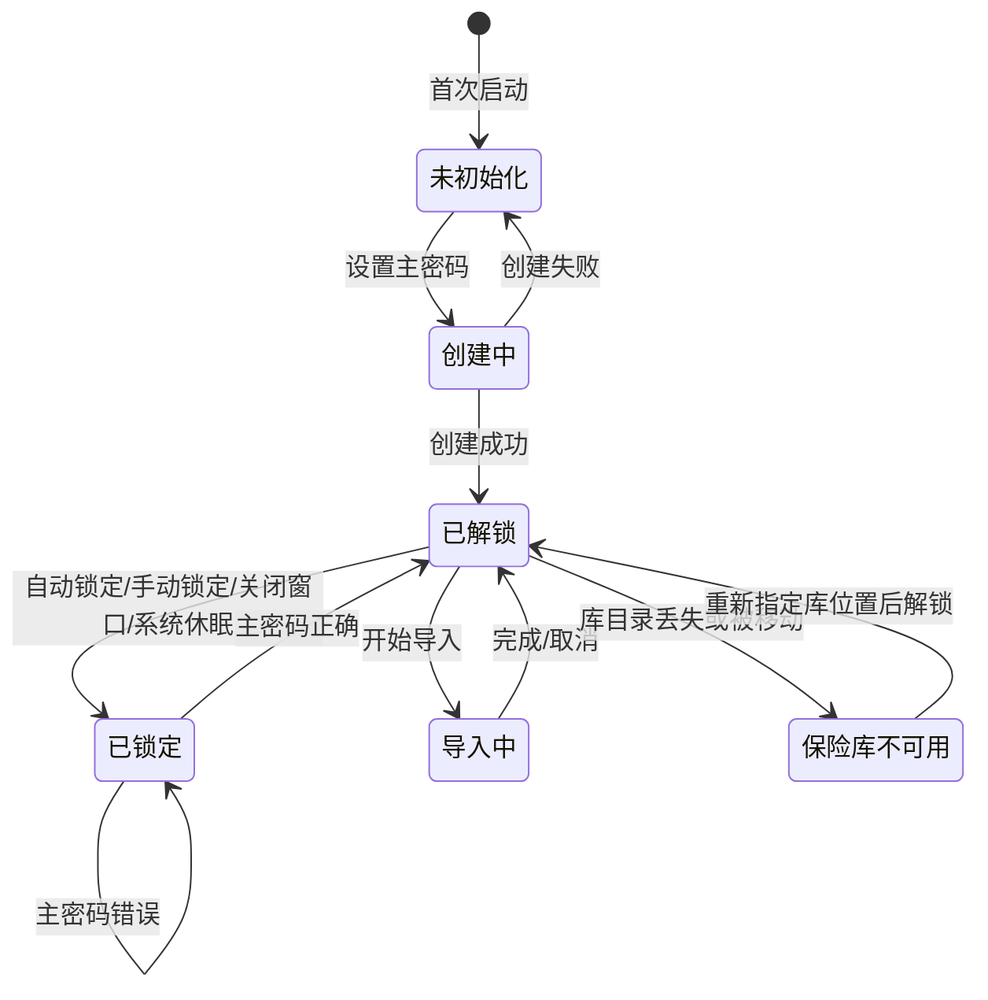
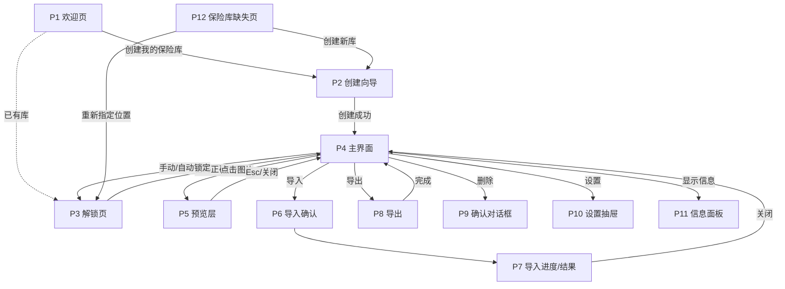

# Haven 产品需求分析报告

> 版本：v0.1（需求分析稿）
> 产品形态：本地桌面应用（Tauri + Vue 3 + Rust + Naive UI + SQLite）
> 文档范围：**只描述产品行为与业务规则，不涉及技术架构、加密算法选型、数据库设计与接口设计。**

---

## 0. 阅读约定

### 0.1 标记说明

| 标记 | 含义 |
| --- | --- |
| `FR-xx` | MVP 必须实现的功能需求 |
| `P1-xx` | 后续版本功能，MVP 不实现 |
| `[TBD]` | 信息缺失，需要产品决策，不做假设 |
| `[假设]` | 为推进文档而做的合理默认判断，需用户确认 |
| `[非目标]` | 明确不做的事情，用于防止范围蔓延 |

### 0.2 关键术语（全文统一）

| 术语 | 定义 |
| --- | --- |
| 保险库（Vault） | 一个受主密码保护的本地加密容器，是所有文件的唯一存放位置。MVP 中整个应用只有一个保险库。 |
| 主密码 | 用户设置的、用于解锁保险库的唯一口令。不存储明文，不可找回。 |
| 文件条目 | 保险库中一条被加密保存的文件记录，拥有独立的显示名、类型、大小、导入时间。 |
| 解锁 / 锁定 | 解锁 = 主密码校验通过、文件内容可被应用读取；锁定 = 应用不再持有可解密的能力，界面不展示任何文件内容。 |
| 回收站 | 被删除但仍占用空间的文件条目的暂存区，可恢复或彻底删除。 |

### 0.3 全局约束（贯穿所有需求）

| 编号 | 约束 |
| --- | --- |
| C-1 | 离线优先：应用在**完全断网**环境下必须 100% 可用，无任何降级。 |
| C-2 | 无云端：不引入任何账号体系、云同步、远程存储、在线 AI 服务。 |
| C-3 | 无网络请求：应用运行期间不发起任何外部网络连接（含遥测、崩溃上报、更新检查、字体/图标 CDN）。 |
| C-4 | 数据主权：所有数据仅存在于用户本机磁盘，用户可随时整体复制、迁移、删除。 |
| C-5 | 单用户单机：不做账号、不做多用户权限，权限边界 = 操作系统账户边界。 |

---

## 1. 产品定位与目标用户

### 1.1 一句话定位

Haven 是一个「本机上的私人抽屉」：把不想被随意翻看的照片和文件，放进一个只有自己密码能打开的加密空间，平时安静、打开顺手、不用时自动上锁。

### 1.2 产品要解决的问题

| 现状问题 | 用户的实际感受 |
| --- | --- |
| 私人照片、证件扫描件、财务文件以明文散落在桌面、下载目录、相册中 | 电脑借人、送修、被家人打开时，内容一览无余 |
| 已有加密工具（压缩包加密、磁盘加密镜像）操作繁琐 | 每次存取都要"压缩—加密—改后缀—再解压"，无法当日常工具用 |
| 隐私工具界面偏"工程师向"或偏"监控向" | 使用过程有压力感，不想天天打开 |

### 1.3 目标用户

**核心用户（MVP 唯一服务对象）**

- 单机个人用户，拥有一台属于自己的 Mac（[TBD] 是否 MVP 同时覆盖 Windows）。
- 有 10~2000 个量级的私人文件需要保护，以照片、截图、证件扫描件、PDF 为主。
- 不具备加密技术知识，**不会**判断算法强度、密钥管理、威胁模型。
- 使用动机是"防止被随手看到"，而非对抗专业取证。[假设]

**典型画像（[假设]，需验证）**

| 维度 | 描述 |
| --- | --- |
| 年龄 | 22~45 |
| 技术水平 | 普通电脑使用者，能拖拽文件、能记住一个密码 |
| 使用频次 | 每周 1~5 次，单次 1~10 分钟 |
| 关键心理 | 想要"安全感"，但不想要"仪式感" |

**非目标用户（明确不服务）**

- 企业团队、需要多人共享密钥的场景 `[非目标]`
- 需要合规审计、司法取证、密钥托管的场景 `[非目标]`
- 需要跨设备实时同步的用户 `[非目标]`
- 需要隐藏"存在加密行为"本身的用户（本产品不提供可否认性）`[非目标]`

### 1.4 产品边界

**做：** 加密存储、快速浏览、快速取用、自动上锁、可随时导出。

**不做：** 云同步、账号、分享链接、在线协作、文件编辑、图片修图、密码管理器、系统级全盘加密。

> 与系统能力的分工：Haven 保护的是"应用内这份副本"，不负责保护用户从 Haven 导出到桌面的文件，也不替代 FileVault 类的全盘加密。这一点必须在产品内被用户理解，而不是靠文档。

### 1.5 与"信任"有关的定位判断

用户把最私密的东西交给一个看不懂内部原理的软件，产品必须用**可感知的行为**建立信任，而不是用技术名词。具体要求见第 9 章。

---

## 2. 核心使用场景

### 场景 A：收纳（最高频）

小林从手机同步了 40 张身份证、护照、体检报告照片到电脑，散落在"下载"文件夹。她把它们全选拖进 Haven，Haven 加密保存，她随后手动删除下载目录里的原件。此后这些照片不再出现在系统相册和最近文件中。

- 触发点：产生了新的私密文件
- 完成判据：文件已进入保险库，界面可见，原位置不再需要保留

### 场景 B：取用（次高频）

需要给房东发一张身份证照片。小林打开 Haven，输入密码，找到图片，右键导出到桌面，发送后删除桌面副本，点击"锁定"。

- 完成判据：文件出现在用户指定目录，且用户清楚"该副本已不受保护"

### 场景 C：随手查看

夜深时想翻一下自己的旧照片，但不想让这些照片出现在系统相册里。打开 Haven → 解锁 → 网格浏览 → 全屏查看 → 关闭窗口（自动锁定）。

### 场景 D：误删恢复

整理时误删了一个文件夹里的 12 张图。进入回收站，全选恢复，回到原分类。

### 场景 E：换机 / 备份

换新电脑前，把手上的保险库目录整体拷贝到移动硬盘；新电脑安装 Haven 后指向该目录，用同一个主密码解锁。

### 场景 F：别人用我的电脑

朋友借用电脑。Haven 处于锁定状态，双击图标只看到密码输入框，看不到任何文件名、缩略图或数量。

---

## 3. 用户使用流程

### 3.1 首次使用（一次性）

```
启动应用
  → 欢迎页（说明：本地存储 / 无云端 / 忘记密码无法找回）
  → 点击「创建我的保险库」
  → 设置主密码（输入 + 确认 + 强度提示 + 显示/隐藏切换）
  → 勾选「我已了解：忘记主密码将无法恢复任何文件」
  → 点击「创建」
  → 创建进度（加密初始化）
  → 进入主界面（已解锁、空状态）
```

**异常分支**

- 两次密码不一致 → 就地提示，停留在当前步骤
- 密码长度不足 → 就地提示，不可继续
- 创建过程中磁盘不可写 / 空间不足 → 创建失败，回到密码步骤，**不留下半成品保险库**

### 3.2 日常启动与锁定

```
启动应用
  → 若已存在保险库 → 解锁页（显示库名 + 密码框，不显示任何文件信息）
  → 输入正确密码 → 主界面
  → 使用中（无操作计时）
  → 达到自动锁定时间 / 系统休眠唤醒 / 点击锁定 / 关闭窗口
  → 回到解锁页
```

### 3.3 导入流程

```
主界面点击「导入」或拖拽文件到窗口
  → 选择文件（系统文件选择器，支持多选）或拖入文件/文件夹
  → 导入前确认面板（数量、总大小、同名处理方式、源文件是否保留）
  → 开始导入（逐条进度 + 可取消）
  → 完成汇总（成功 N 个 / 失败 M 个 / 跳过 K 个）
  → 列表刷新，新文件置顶高亮
```

### 3.4 查看流程

```
主界面网格 → 点击缩略图 → 全屏预览
  → 左右切换 / 缩放
  → Esc 或关闭 → 回到网格（保持滚动位置与选中状态）
```

### 3.5 导出（取用）流程

```
选中 1 个或多个文件 → 点击「导出」
  → 选择目标文件夹
  → 导出进度
  → 完成提示：「已导出到 <路径>。导出后的文件不再受 Haven 保护。」
  → 提供「在访达中显示」按钮
```

### 3.6 删除与恢复流程

```
选中文件 → 删除 → 确认对话框 → 移入回收站
回收站 → 选中 → 恢复（回到原分类）/ 彻底删除（二次确认，不可恢复）/ 清空回收站
```

### 3.7 完整生命周期状态机



---

## 4. 核心功能模块总览

| 模块 | 目标 | 版本 | 需求编号 |
| --- | --- | --- | --- |
| M1 保险库与解锁 | 创建、解锁、锁定、自动锁定 | MVP | FR-01 ~ FR-09 |
| M2 文件导入 | 把外部文件安全收进保险库 | MVP | FR-10 ~ FR-18 |
| M3 浏览与检索 | 找到目标文件 | MVP | FR-19 ~ FR-25 |
| M4 预览 | 不落地明文地查看内容 | MVP | FR-26 ~ FR-31 |
| M5 文件管理 | 重命名、删除、回收站、恢复 | MVP | FR-32 ~ FR-38 |
| M6 导出 | 把文件取回到系统目录 | MVP | FR-39 ~ FR-43 |
| M7 设置 | 锁定策略、外观、库信息 | MVP | FR-44 ~ FR-49 |
| M8 安全与隐私 | 贯穿性约束 | MVP | 见第 9 章 |
| M9 多库 | 多个独立保险库 | P1 | P1-01 |
| M10 组织能力 | 相册、标签、文件夹层级 | P1 | P1-02 ~ P1-04 |
| M11 更多预览格式 | PDF、视频、文本 | P1 | P1-05 |
| M12 生物识别解锁 | Touch ID | P1 | P1-06 |
| M13 备份与迁移 | 引导式备份、换机迁移 | P1 | P1-07 |
| M14 主密码变更 | 修改主密码 | P1 | P1-08 |

> 模块依赖关系（用于后续架构拆分）：M2/M3/M4/M5/M6 全部依赖 M1 的「已解锁」状态；M6 是唯一的"明文出口"，因此安全约束最重。

---

## 5. MVP 范围

### 5.1 MVP 定义

**MVP = 一条能完整跑通的闭环旅程**：

> 创建一个保险库 → 把文件导入进去 → 能浏览和查看 → 能取出来 → 能删除和恢复 → 关掉后别人打不开。

任何不服务于这条闭环、或不能支撑其异常恢复的功能，都不进 MVP。

### 5.2 MVP 功能清单（做 / 不做）

| 能力 | MVP | 说明 |
| --- | --- | --- |
| 创建保险库 + 设置主密码 | ✅ | 单一保险库 |
| 解锁 / 锁定 / 自动锁定 / 休眠强制锁定 | ✅ | |
| 导入文件（多选、拖拽、文件夹） | ✅ | 文件夹递归导入时扁平化 |
| 同名冲突处理 | ✅ | 自动重命名，不做覆盖 |
| 网格 / 列表浏览 | ✅ | |
| 图片缩略图 | ✅ | 加密保存 |
| 搜索（按文件名）、类型筛选、排序 | ✅ | |
| 图片全屏预览 | ✅ | 仅图片 |
| 重命名、删除、回收站、恢复、彻底删除 | ✅ | |
| 导出单个 / 批量 | ✅ | 唯一明文出口 |
| 设置：自动锁定时间、主题、库位置、关于 | ✅ | |
| 空状态、错误提示、进度与取消 | ✅ | |
| 多保险库 | ❌ | P1 |
| 相册 / 标签 / 文件夹层级 | ❌ | P1 |
| PDF / 视频 / 文本预览 | ❌ | P1 |
| Touch ID 解锁 | ❌ | P1 |
| 修改主密码 | ❌ | P1（涉及全库重加密，风险高，不放进 MVP） |
| 密码找回 / 密保问题 | ❌ | `[非目标]` 与"不可找回"的安全承诺冲突 |
| 云同步 / 账号 / 分享 | ❌ | `[非目标]` |
| 文件编辑、图片编辑 | ❌ | `[非目标]` |
| 密码管理器、剪贴板历史 | ❌ | `[非目标]` |
| 自动备份、备份提醒 | ❌ | P1 |
| 拖拽文件到外部应用打开 | ❌ | P1（会产生明文落地，需专门设计） |
| 多语言 | ❌ | [TBD] 见 Q-11 |

### 5.3 MVP 验收口径

MVP 可判定完成，当且仅当以下 6 条全部成立：

1. 断网环境下，从创建库到导出文件的完整流程无任何阻塞、无任何报错。
2. 在系统文件管理器中查看保险库目录，**看不到任何原始文件名、缩略图或可打开的明文文件**。
3. 锁定状态下（含刚启动未解锁），界面上不出现任何文件名、缩略图、文件数量。
4. 一次性导入 200 个文件（含 3 个同名文件、1 个无权限文件），结果为 199 成功 + 1 失败并给出可读原因，应用不崩溃。
5. 强制结束进程后重启，已完成导入的文件全部完好；未完成的导入不产生"幽灵条目"。
6. 导出后的文件可正常打开，且导出提示明确告知"该副本已不受保护"。

---

## 6. 功能模块详细需求

> 每个需求按「触发 → 规则 → 结果 → 状态变化」描述，可直接转为开发任务与验收用例。

### 6.1 M1 保险库与解锁

#### FR-01 首次启动欢迎页

- **触发**：应用启动且本机不存在保险库。
- **内容**：产品名、一句话说明、三条核心承诺（数据只在本机 / 无需联网 / 忘记密码无法找回）、主按钮「创建我的保险库」。
- **规则**：不展示任何技术名词（如"加密算法""密钥派生"）；不提供"稍后再说"导致的无库主界面。
- **结果**：点击主按钮进入 FR-02。

#### FR-02 设置主密码

- **触发**：欢迎页点击创建。
- **输入项**：主密码、确认密码、显示/隐藏切换、密码强度提示。
- **规则**：
  - 长度下限 8 位；不强制大小写/符号组合（避免用户写便签）。
  - 强度提示仅给出"偏弱 / 一般 / 较强"三档，并给出可执行建议（加长、避免使用生日）。
  - 实时校验：两次不一致时禁用「下一步」。
  - 密码不写入日志、不写剪贴板、不做自动填充。
- **状态变化**：密码通过校验后进入 FR-03。
- **异常**：不做弱密码强制拦截（仅提示），理由见 Q-02。

#### FR-03 不可找回确认

- **触发**：密码步骤通过。
- **规则**：必须勾选「我已了解：忘记主密码将无法恢复任何文件，Haven 不提供找回方式」才能点击「创建」。勾选状态不默认选中，不记忆。
- **理由**：这是全产品唯一不可逆的承诺，必须显式取得用户确认。

#### FR-04 创建保险库

- **触发**：确认后点击「创建」。
- **过程**：显示不确定进度（非百分比），文案「正在创建保险库…」，期间禁止关闭窗口（关闭时二次确认）。
- **结果**：创建成功后直接进入已解锁的主界面（空状态）。
- **失败处理**：磁盘不可写、空间不足、目标目录被占用 → 提示具体原因 + 「重试」「返回」；失败后磁盘上不留半成品目录。
- **状态变化**：未初始化 → 已解锁。

#### FR-05 解锁

- **触发**：应用启动时已存在保险库；或处于锁定状态。
- **界面**：库名、密码输入框、「解锁」按钮。**不展示**文件数量、缩略图、最近文件。
- **规则**：
  - 输入正确 → 进入主界面，焦点落在搜索框或内容区。
  - 输入错误 → 输入框下提示「密码不正确」，清空输入框，光标回到密码框。
  - 不做错误次数锁定（离线场景下次数限制无法阻止本地暴力尝试，真正防线是密码强度与加密强度）。理由与风险见 Q-03。
  - 解锁过程超过 2 秒时显示「正在解锁…」。
- **状态变化**：已锁定 → 已解锁。

#### FR-06 手动锁定

- **触发**：主界面点击「锁定」（或快捷键 `⌘L`）。
- **规则**：立即关闭所有预览层；清空界面上的文件内容；回到解锁页。若有导入/导出进行中，先询问「操作进行中，确定锁定？」。

#### FR-07 自动锁定

- **触发**：已解锁状态下无鼠标/键盘操作达到设定时长。
- **规则**：
  - 默认 5 分钟；可选 1 / 5 / 15 / 30 分钟 / 从不。
  - 计时在导入、导出、预览全屏时是否暂停 `[TBD]` 见 Q-04；默认：导入/导出进行中不锁定，操作结束后重新计时。
  - 锁定前 10 秒不做弹窗倒计时（避免打断），直接锁定。
- **结果**：回到解锁页。

#### FR-08 强制锁定场景

| 场景 | 行为 |
| --- | --- |
| 系统休眠 / 睡眠唤醒 | 立即锁定，不可关闭该策略 |
| 关闭主窗口 | 应用进程退出（见 Q-05）或最小化到托盘 `[TBD]`，无论哪种都处于锁定状态 |
| 应用崩溃 / 被强制结束 | 重启后处于锁定状态 |
| 切换系统用户 | 锁定 |

#### FR-09 保险库不可用

- **触发**：库目录被删除、被移动到其他位置、或所在磁盘未挂载。
- **规则**：启动时检测不到库 → 显示独立页面「找不到你的保险库」，提供「重新指定位置」与「创建新保险库」。
- **约束**：不得在用户未确认的情况下自动创建新库覆盖原路径。

### 6.2 M2 文件导入

#### FR-10 导入入口

- **方式一**：主界面「导入文件」按钮 → 系统文件选择器（多选）。
- **方式二**：从系统文件管理器拖拽文件/文件夹到窗口（已解锁状态）。
- **方式三**：拖拽到 Dock/任务栏图标 `[TBD]`，MVP 可先不支持。
- **锁定状态**：拖拽到锁定页应提示「请先解锁」，不接收内容。

#### FR-11 导入前确认

- **展示**：文件总数、总大小、按类型分布（图片 N / 文档 N / 其他 N）。
- **选项**：
  - 同名文件处理：「自动重命名（推荐）」为默认且 MVP 唯一选项。
  - 源文件处理：「保留原文件（推荐，默认）」/「导入成功后删除原文件」。见 Q-01。
- **规则**：总大小为 0 或全部不可读时禁用「开始导入」。
- **可跳过**：单次导入少于 5 个文件时，确认面板可折叠为一行摘要，用户可直接开始。

#### FR-12 文件夹导入

- **规则**：递归扫描子目录，**全部文件扁平化导入**，不保留目录结构（MVP 无文件夹概念）。
- **提示**：确认面板注明「将导入该文件夹内全部 X 个文件，不保留目录结构」。
- **排除**：跳过隐藏文件与系统文件（如 `.DS_Store`）；跳过符号链接以免循环。

#### FR-13 导入过程

- **展示**：逐条进度（当前文件名需脱敏？见 FR-44 设置项，MVP 直接显示文件名）、总进度条、已用时间、取消按钮。
- **规则**：
  - 串行导入，单个失败不中断整体。
  - 点击「取消」→ 停止后续文件，已完成文件保留，弹出汇总。
  - 导入期间允许继续浏览已有文件，但禁止锁定以外的破坏性操作。
- **状态变化**：已解锁 → 导入中 → 已解锁。

#### FR-14 同名冲突

- **规则**：与库内已有文件同名时，自动重命名为 `原名 (1).扩展名`、`原名 (2).扩展名`，序号递增直到不冲突。
- **约束**：MVP **不提供覆盖**，避免误删数据。
- **结果**：汇总中列出「Y 个文件已自动重命名」。

#### FR-15 文件类型与大小

- **类型**：不限制扩展名，任何文件都可导入；分类仅用于浏览筛选（见 FR-22）。
- **单文件大小**：MVP 不设上限，但超过 1GB 时在确认面板提示「该文件较大，导入可能需要较长时间」。
- **非法文件名**：文件名含控制字符或长度超过系统限制时，导入后使用「未命名文件」+ 序号作为显示名，并在详情中可见原始名（仅本次会话内存中保留）。

#### FR-16 导入完成汇总

- **展示**：成功 N / 失败 M / 跳过 K；失败项可展开查看「文件名 + 原因」。
- **原因文案**（面向用户，不暴露技术错误码）：文件不存在、没有读取权限、磁盘空间不足、文件正在被其他程序使用、其他错误。
- **结果**：列表自动刷新并滚动到新导入文件；新文件带 2 秒高亮。

#### FR-17 导入中断恢复

- **触发**：导入过程中应用崩溃、断电、被强杀。
- **规则**：重启后已完成文件完整可用；未完成文件不出现在列表；不产生 0 字节的残留条目。
- **提示**：若检测到上次导入未完成，显示一次 Toast「上次导入未完成，已完成的部分已保存」。

#### FR-18 重复导入同一文件

- **规则**：不做内容去重（按"内容相同"判断并跳过是 P1 能力）。同名文件按 FR-14 重命名，因此同一文件导入两次会得到两个条目。
- **理由**：内容去重需要对全库做比对，成本与感知收益不匹配 MVP，见 Q-06。

### 6.3 M3 浏览与检索

#### FR-19 主界面布局

```
┌──────────────────────────────────────────────────────┐
│ 库名        [ 🔍 搜索文件名 ]      [导入] [锁定] [⚙] │
├──────────┬───────────────────────────────────────────┤
│ 全部文件 │  [视图切换] [排序 ▾]        [多选操作条] │
│ 图片     │                                           │
│ 文档     │         缩略图网格 / 文件列表              │
│ 其他     │                                           │
│ ──────   │                                           │
│ 回收站   │                                           │
└──────────┴───────────────────────────────────────────┘
```

#### FR-20 分类导航

| 分类 | 判定规则 |
| --- | --- |
| 全部文件 | 不在回收站的全部条目 |
| 图片 | `jpg/jpeg/png/gif/webp/heic/heif/bmp/tiff` |
| 文档 | `pdf/txt/md/doc/docx/xls/xlsx/ppt/pptx/csv` |
| 其他 | 其余扩展名及无扩展名文件 |
| 回收站 | 已删除条目 |

- **规则**：分类由扩展名推断，导入时计算一次并存储；重命名不改变分类。
- **未知扩展名**：归入「其他」，不报错。

#### FR-21 视图模式

- **网格（默认）**：固定缩略图尺寸，每组 4~6 列随窗口宽度自适应；非图片文件显示类型图标 + 文件名。
- **列表**：文件名、类型、大小、导入时间四列，可排序。
- **记忆**：视图模式、排序方式在本地记忆（属应用设置，不含文件信息）。

#### FR-22 排序

- 可选项：导入时间（默认，倒序）、文件名（升/降）、大小（升/降）。
- **并列规则**：数值相同时按导入时间倒序，保证顺序稳定。

#### FR-23 搜索

- **范围**：当前分类内的文件名模糊匹配（不区分大小写，支持中文）。
- **规则**：输入即搜，防抖后出结果；无结果时显示「没有找到包含「X」的文件」+ 清除按钮。
- **限制**：MVP 不搜索文件内容（内容检索属于后续能力）。

#### FR-24 空状态

| 场景 | 文案与操作 |
| --- | --- |
| 库为空 | 「这里还没有文件」+ 「导入第一个文件」按钮 + 一句安抚文案（如"放轻松，这里只有你能打开"） |
| 某分类为空 | 「该分类下还没有文件」+ 「查看全部文件」链接 |
| 搜索无结果 | 见 FR-23 |
| 回收站为空 | 「回收站是空的」 |

#### FR-25 列表性能表现

- **要求**：1000 个条目时，滚动与切换分类不出现明显卡顿（主观标准：无超过 300ms 的白屏）。
- **缩略图**：只对可视区域及临近区域加载；滚动中出现占位灰块而非空白跳动。

### 6.4 M4 预览

#### FR-26 图片预览

- **触发**：网格中点击图片缩略图，或列表双击。
- **行为**：全屏预览层，深色背景，图片按比例完整显示（不裁切）。
- **支持格式**：`jpg/jpeg/png/gif/webp/heic/heif/bmp/tiff`；GIF 播放动图；HEIC/HEIF 需能正确解码（若无法解码，按 FR-29 处理）。

#### FR-27 预览交互

| 操作 | 行为 |
| --- | --- |
| `←` / `→` 或点击左右区域 | 切换到当前列表中的上一张/下一张 |
| 滚轮 / 触控板捏合 | 以指针位置为中心缩放 |
| 双击 | 在「适应窗口」与「100%」之间切换 |
| 拖动 | 放大状态下平移 |
| `Esc` | 关闭预览 |

- **顺序**：预览按当前分类 + 当前排序顺序切换，不跨分类。
- **边界**：第一张再按左键无动作（不循环），最后一张同理；按钮置灰。

#### FR-28 预览信息

- 顶部或底部浮层显示：文件名、大小、导入时间。
- 不显示原始来源路径（隐私考虑，见 9.3）。

#### FR-29 无法预览

- **规则**：图片损坏、格式不被支持（如 `heic` 解码失败）、文件为 0 字节 → 显示占位图标 + 「无法预览此文件」+ 「导出后查看」按钮。
- **不得**：静默显示空白。

#### FR-30 非图片文件的预览

- **MVP**：不内置预览。点击非图片文件 → 显示信息面板（文件名、类型、大小、导入时间）+ 「导出后查看」按钮 + 说明「为避免在磁盘留下未加密副本，Haven 不在此打开该文件」。
- **理由**：用系统程序打开必须先落地明文，与产品安全承诺冲突，需专门设计后再做（P1-05 / Q-07）。

#### FR-31 预览的隐私行为

- 预览内容不写入磁盘（无临时缓存明文）。
- 锁定发生时立即关闭预览层。
- 预览期间不修改文件（只读）。

### 6.5 M5 文件管理

#### FR-32 重命名

- **触发**：右键菜单 / 选中后操作条「重命名」。
- **规则**：默认选中主文件名、保留扩展名；不允许为空；长度上限 100 字符；不允许 `/` 等系统非法字符。
- **冲突**：与库内其他文件同名时提示「已存在同名文件」，需改名后才能保存。
- **结果**：列表即时更新，并按当前排序重新定位。

#### FR-33 删除到回收站

- **触发**：选中 1~N 个文件 → 删除（`Delete` 或右键菜单）。
- **规则**：弹出确认「将 N 个文件移入回收站？」；确认后移入回收站，文件仍占用空间。
- **撤销**：删除后 Toast 提供 5 秒「撤销」，撤回则恢复到原分类。

#### FR-34 回收站

- **展示**：与主列表一致的网格/列表，额外显示「删除时间」；顶部显示「共 N 个文件，占用 X MB」。
- **操作**：恢复、彻底删除、清空回收站。
- **规则**：回收站内容不参与自动锁定以外的特殊处理，锁定时同样不可见。

#### FR-35 恢复

- **规则**：恢复到原分类（不保留"原位置"，MVP 无文件夹概念）；若同名文件已存在，自动重命名。

#### FR-36 彻底删除

- **触发**：回收站内删除 / 清空。
- **规则**：明确二次确认，文案必须写明「永久删除，无法恢复」；确认后条目从列表移除，占用空间释放。
- **不可逆**：不提供撤销。

#### FR-37 多选

- **规则**：`⌘` 点选、`Shift` 连选、`⌘A` 全选当前列表；多选后顶部出现操作条（导出 / 删除 / 取消选择）。
- **限制**：重命名仅支持单选。

#### FR-38 详情面板

- **触发**：右键「显示信息」。
- **内容**：文件名、类型、大小、导入时间、所在分类、是否在回收站。
- **不含**：原始磁盘路径、任何派生密钥信息。

### 6.6 M6 导出

#### FR-39 导出入口

- 选中文件 → 「导出」→ 系统目录选择器。
- 支持单个与批量；批量时全部导出到同一目录。

#### FR-40 导出规则

- **文件名**：使用当前显示名。
- **冲突**：目标目录已存在同名文件 → 自动重命名为 `原名 (1).扩展名`，并在完成提示中说明。
- **约束**：MVP 不提供"覆盖"选项。

#### FR-41 导出进度与取消

- 显示逐条进度与整体进度；可取消，已导出的文件保留在目标目录。
- 导出期间锁定策略见 FR-07。

#### FR-42 导出后的安全提示

- 完成提示必须包含：「已导出到 <路径>。导出的文件是未加密副本，不再受 Haven 保护。」
- 提供「在访达中显示」与「删除已导出文件」两个快捷操作（后者为一次性，避免用户误留明文）。
- **理由**：这是产品最容易被误解的地方，必须显式提示而不是写在帮助文档里。

#### FR-43 导出失败

- 逐条失败不中断整体，汇总给出原因（目标无写入权限、磁盘空间不足、目标文件被占用）。
- 失败的文件在列表中不标记状态（避免引入复杂状态机），仅通过汇总告知。

### 6.7 M7 设置

| 编号 | 设置项 | 规则 |
| --- | --- | --- |
| FR-44 | 自动锁定时间 | 1 / 5（默认）/ 15 / 30 分钟 / 从不。选择「从不」时显示风险提示但允许。 |
| FR-45 | 主题 | 浅色 / 深色 / 跟随系统，默认跟随系统。 |
| FR-46 | 保险库位置 | 只读展示路径 + 「在访达中显示」。MVP 不支持在应用内迁移（P1-07）。 |
| FR-47 | 立即锁定 | 等同 FR-06。 |
| FR-48 | 关于 | 版本号、许可信息、隐私声明入口（本地文本，不打开网页）。 |
| FR-49 | 退出应用 | 退出前若存在进行中的导入/导出，二次确认。 |

- **不包含**：修改主密码（P1-08）、备份设置、清空数据（作为独立危险操作，见 Q-08）。

### 6.8 全局交互要求

- **快捷键**：`⌘L` 锁定、`⌘F` 聚焦搜索、`⌘I` 导入、`Esc` 关闭当前层。
- **加载与反馈**：任何超过 300ms 的操作都需要可见的状态反馈（骨架屏、进度条、按钮 loading）。
- **错误提示**：使用「发生了什么 + 用户能做什么」的双段文案，禁止只显示错误码。
- **不可用状态**：按钮禁用时需可通过 hover 提示说明原因。

---

## 7. 页面结构与跳转关系

### 7.1 页面清单

| 编号 | 页面 | 类型 | 出现条件 |
| --- | --- | --- | --- |
| P1 | 欢迎页 | 全屏页 | 首次启动、无保险库 |
| P2 | 创建保险库向导 | 全屏页（3 步） | 从 P1 进入 |
| P3 | 解锁页 | 全屏页 | 已存在库且处于锁定态 |
| P4 | 主界面 | 全屏页 | 已解锁 |
| P5 | 预览层 | 全屏覆盖层（模态） | 从 P4 打开图片 |
| P6 | 导入确认面板 | 对话框 | 从 P4 触发导入 |
| P7 | 导入进度 / 结果 | 对话框 | 确认后 |
| P8 | 导出目录选择与进度 | 系统对话框 + 应用内进度 | 从 P4 多选后 |
| P9 | 确认对话框（删除/彻底删除/清空） | 对话框 | 破坏性操作前 |
| P10 | 设置面板 | 侧边抽屉 | 从 P4 顶部齿轮 |
| P11 | 文件信息面板 | 侧边抽屉 | 右键「显示信息」 |
| P12 | 保险库缺失页 | 全屏页 | 启动时找不到库 |

### 7.2 跳转关系



### 7.3 页面关系约束

| 约束 | 说明 |
| --- | --- |
| 锁定即清屏 | 任何页面在锁定时都必须立即消失，不存在"锁定态下残留的预览层" |
| 单一入口 | 只有 P3 能进入 P4；不存在从 P2 之外绕过解锁进入 P4 的路径 |
| 破坏性操作必经 P9 | 删除、彻底删除、清空回收站、退出时中断任务，都必须经过确认对话框 |
| 层级最深两层 | 全屏页 → 模态/抽屉，禁止三层嵌套弹窗（避免用户迷路） |

---

## 8. 异常场景与边界情况

### 8.1 解锁与保险库

| 场景 | 预期行为 | 用户可见反馈 | 数据后果 |
| --- | --- | --- | --- |
| 密码输错 | 停留解锁页 | 「密码不正确」，清空输入 | 无 |
| 连续多次输错（如 10 次） | 不锁定、不延迟 `[TBD]` 见 Q-03 | 仅重复提示 | 无 |
| 密码含全角字符 / 输入法未切换 | 按实际输入字符校验 | 提供「显示密码」以便用户自查 | 无 |
| 粘贴密码时带首尾空格 | 明确规则：**保留空格**（密码即密码），但提示"注意密码首尾可能包含空格" `[假设]` | 提示文案 | 无 |
| 保险库目录被删除 | 进入 P12 | 「找不到你的保险库」+ 重建入口 | 无（数据已丢失，不自动重建） |
| 保险库目录被移动到别处 | 进入 P12，可重新指定位置 | 重新指定后正常解锁 | 无 |
| 保险库文件被外部程序修改/损坏 | 解锁时校验失败 | 「保险库可能已损坏」+ 提供备份恢复指引，不覆盖原文件 | 只读，不写入 |
| 两个应用实例同时打开同一库 | 第二个实例拒绝解锁 | 「保险库正在被另一个 Haven 窗口使用」 | 无，避免写入冲突 |
| 解锁时磁盘只读 | 允许浏览与预览，禁止写入类操作 | 写入类按钮禁用并说明原因 | 无 |

### 8.2 导入

| 场景 | 预期行为 |
| --- | --- |
| 导入 0 个文件 | 不允许开始，提示「没有可导入的文件」 |
| 文件在导入过程中被其他程序删除 | 该条目标记为失败，原因「文件不存在」，继续后续 |
| 文件被其他程序占用（Windows 常见） | 失败，原因「文件正在被其他程序使用」 |
| 无读取权限 | 失败，原因「没有读取权限」 |
| 磁盘空间不足 | 失败并**立即停止后续导入**（避免逐个失败浪费用户时间），提示所需/可用空间 |
| 文件夹中包含 10000 个文件 | 确认面板提示总量；导入进度以"已处理/总数"呈现；允许取消 |
| 文件名超长（>255 字节） | 显示名截断并加序号，导入成功 |
| 文件名含 emoji / 稀有字符 | 正常导入与展示；若字体缺失，显示占位方框但不报错 |
| 导入的是保险库自身目录 | 拒绝并提示「不能把保险库导入到自身」，避免无限递归 |
| 拖入的是快捷方式/符号链接 | 跳过并在汇总中说明 |
| 导入过程中用户锁定 | 先询问，确认后取消导入并保留已完成部分 |
| 导入过程中系统休眠 | 暂停导入，唤醒后继续（若平台不支持则失败并按 FR-17 处理） |

### 8.3 浏览与预览

| 场景 | 预期行为 |
| --- | --- |
| 库内 1000+ 文件 | 虚拟滚动，缩略图按需加载，滚动不白屏 |
| 缩略图生成失败（损坏图片） | 显示通用图片占位图标，不阻塞列表 |
| 预览第一张按左键 | 按钮置灰，无动作，不循环 |
| 预览中删除当前文件 | 关闭预览，回到列表，Toast 提示已移入回收站 |
| 预览中文件被外部删除 | 同库内删除，提示文件已不存在 |
| 超宽/超长图片（如 20000×300） | 按适应窗口显示，缩放不卡死 |
| GIF 动图 | 播放，锁定后立即停止 |
| 窗口极窄（<800px） | 侧栏收起为图标，网格列数减少，不出现横向滚动条 |

### 8.4 删除、导出与退出

| 场景 | 预期行为 |
| --- | --- |
| 删除后立即点撤销 | 5 秒内恢复成功；超过 5 秒无法撤销，按钮消失 |
| 清空回收站时磁盘繁忙 | 逐条删除，部分失败则保留失败条目并提示重试 |
| 导出到无权限目录 | 整体失败并提示「没有写入权限，请选择其他位置」 |
| 导出时目标磁盘空间不足 | 停止导出，提示已成功 N 个、失败 M 个 |
| 导出时目标目录存在同名文件 | 自动重命名，完成提示中说明 |
| 导出过程中锁定 | 询问后取消导出，保留已导出文件 |
| 导出过程中退出应用 | 二次确认；确认后终止，已导出文件保留 |
| 窗口关闭 | 见 Q-05：默认退出进程；若实现托盘则最小化并保持锁定 |

### 8.5 系统与平台

| 场景 | 预期行为 |
| --- | --- |
| 完全断网 | 无任何功能受影响，无任何网络错误提示 |
| 系统时间被修改 | 文件列表按导入时间排序可能异常，但不影响数据；不依赖系统时间做安全判断 |
| 屏幕缩放 150% / 200% | 布局不重叠、不截断 |
| 中文 / 英文系统语言 | MVP 界面语言见 Q-11 |
| 系统主题切换（浅色 ↔ 深色） | 实时跟随，不重启 |

---

## 9. 数据安全与隐私的产品要求

> 本章只写**产品级可验收的要求**，不指定算法、参数或存储实现。

### 9.1 硬性要求（违反即视为产品缺陷）

| 编号 | 要求 | 验收方式 |
| --- | --- | --- |
| SEC-01 | 锁定状态下，磁盘上不存在可被直接打开的任何文件明文 | 在系统文件管理器中遍历保险库目录，所有文件均无法用常规程序打开 |
| SEC-02 | 磁盘上不出现明文文件名与明文目录结构 | 用文本搜索工具在库目录内检索已知文件名，无命中 |
| SEC-03 | 磁盘上不出现明文缩略图 | 浏览库目录，无任何可识别的图片文件 |
| SEC-04 | 锁定时不展示任何文件信息 | 锁定后界面仅剩密码输入，无文件名、无数量、无缩略图 |
| SEC-05 | 主密码不以任何形式落盘 | 在库目录与应用配置目录中检索密码字符串，无命中 |
| SEC-06 | 应用运行期间不发起外部网络连接 | 断网可用 + 网络活动监控无对外请求 |
| SEC-07 | 无遥测、无崩溃上报、无自动更新联网 | 检查应用内无相关设置项与请求 |
| SEC-08 | 日志不含文件名、路径、密码、文件内容 | 触发各类操作后检查日志文件 |
| SEC-09 | 应用内预览不产生明文临时文件 | 预览前后对比系统临时目录，无新增可读文件 |
| SEC-10 | 同一保险库不允许被两个进程同时写入 | 双开验证：第二个实例被拒绝 |

### 9.2 用户知情要求

| 编号 | 要求 |
| --- | --- |
| SEC-11 | 创建库时必须显式确认「忘记密码无法找回」 |
| SEC-12 | 首次导入时需用一句话说明「文件在本机加密保存，不会上传到任何地方」 |
| SEC-13 | 每次导出后必须提示「导出的是未加密副本」 |
| SEC-14 | 设置中可查看「本应用不联网」的说明（本地文本页） |
| SEC-15 | 删除到回收站与彻底删除的文案必须区分「可恢复」与「不可恢复」 |

### 9.3 隐私细节决定

| 决策 | 内容 | 理由 |
| --- | --- | --- |
| DP-01 | 不持久化原始文件路径 | 原路径本身是隐私信息（如"离婚协议.pdf"的目录名），且对用户无长期价值 |
| DP-02 | 不记忆主密码、不提供"记住我" | 唯一防线就是密码，任何便利化的记忆都在削弱它 |
| DP-03 | 退出应用即锁定，不保留后台解密态 | 降低"忘记锁了"的风险 |
| DP-04 | 不做文件内容分析（MVP 无 AI、无内容识别） | 与离线承诺一致，也避免误判 |
| DP-05 | 不阻止系统截图与录屏（MVP） | 系统级防护会改变窗口行为，需专门设计，见 Q-09 |
| DP-06 | 备份 = 用户自行复制库目录 | 不引入 Need 之外的能力；产品只需在设置中给出说明 |

### 9.4 明确的安全边界（必须在产品内传达）

- Haven 保护的是**保险库内**的副本；导出后的副本、用户手动放在桌面的原件，均不受保护。
- Haven 不防御：已获得系统管理员权限的恶意程序、键盘记录器、屏幕录制、以及拿到运行中已解锁电脑的人。
- Haven 不提供可否认性：任何人都能看出"这台电脑上有一个 Haven 保险库"。

---

## 10. 后续可扩展功能

> 分级原则：P1 = 已在产品逻辑中预留位置、MVP 不做但明确规划；P2 = 方向合理但需要更多验证；不做 = 与产品定位冲突。

### 10.1 P1（下一版本候选）

| 编号 | 功能 | 为什么放后面 |
| --- | --- | --- |
| P1-01 | 多保险库（如「工作」「私人」） | 需要库切换、库列表、独立锁定状态，MVP 单库模型更干净 |
| P1-02 | 相册 / 自定义集合 | 需要组织模型设计，MVP 先用分类 + 搜索 |
| P1-03 | 标签 | 同上，且需要输入交互设计 |
| P1-04 | 文件夹层级（导入时保留结构） | 与"扁平化"的 MVP 假设直接冲突，需重新设计导入语义 |
| P1-05 | PDF / 文本 / 视频内置预览 | 视频解码与 PDF 渲染成本高；且需要解决"外部程序打开会落地明文"的问题 |
| P1-06 | Touch ID 解锁 | 生物识别只能作为"便利层"，不能替代主密码；需要设计失败回退 |
| P1-07 | 引导式备份与迁移（换机） | 需要处理"备份文件同样需要密码"的认知问题 |
| P1-08 | 修改主密码 | 涉及全库重新加密，失败风险高，需要一次性完成与回滚设计 |
| P1-09 | 内容去重（导入时识别重复文件） | 依赖全库内容比对，性能与体验需验证 |
| P1-10 | 拖拽文件到外部程序打开 | 会产生明文临时文件，需专门的安全设计 |
| P1-11 | 最近导入 / 最近查看 | 需要额外的元数据与"最近"语义定义 |
| P1-12 | 批量重命名规则 | 低频需求，MVP 手动重命名足够 |

### 10.2 P2（待验证）

- 保险库导入/导出为单个归档文件（便于搬运）
- 只读分享（导出加密包给他人，需对方输入口令）
- 自动备份到用户指定外置磁盘
- 文件版本历史（同一文件名保留历史副本）
- 库容量与健康度概览（占用、条目数、最后备份时间）
- 应用锁 + 系统锁联动（如屏幕锁定即锁定 Haven）
- Windows / Linux 平台支持

### 10.3 明确不做

| 功能 | 原因 |
| --- | --- |
| 云同步、网盘对接 | 违背"数据完全由用户掌控"与离线优先 |
| 账号体系 / 多用户协作 | 引入服务端，破坏产品承诺 |
| 在线 AI 分类、人脸识别上云 | 与无网络请求冲突；本地模型为 P2 待验证 |
| 密码找回 / 密保问题 / 恢复码托管 | 与"忘记密码无法找回"的安全承诺冲突 |
| 内置文件编辑器 | 范围蔓延，破坏"安静的工具"定位 |
| 隐藏保险库的存在（可否认性） | 需要完全不同威胁模型，不在本产品定位 |

---

## 11. 关键对象与状态定义（供架构设计对齐）

### 11.1 对象

| 对象 | 属性（产品级） | 说明 |
| --- | --- | --- |
| 保险库 | 名称、创建时间、条目数、占用空间、锁定状态 | 全局唯一（MVP） |
| 文件条目 | 显示名、扩展名、分类、大小、导入时间、状态（正常/回收站）、缩略图 | 不保存原始路径 |
| 应用设置 | 自动锁定时长、主题、视图模式、排序方式 | 不含任何文件内容 |

### 11.2 状态

| 对象 | 状态 | 可迁移到 |
| --- | --- | --- |
| 应用 | 未初始化 / 已锁定 / 已解锁 / 导入中 / 导出中 / 保险库不可用 | 见 3.7 |
| 文件条目 | 正常 / 回收站 | 正常 ↔ 回收站（彻底删除为终态） |
| 缩略图 | 就绪 / 生成中 / 不可用 | — |

### 11.3 分类判定规则（唯一来源）

```
图片 = jpg, jpeg, png, gif, webp, heic, heif, bmp, tiff
文档 = pdf, txt, md, doc, docx, xls, xlsx, ppt, pptx, csv
其他 = 其余（含无扩展名）
```

> 该规则只在导入时计算一次并持久化，避免不同位置重复判断导致不一致。

---

## 12. 不确定项与待确认问题

> 以下问题会实质影响产品范围、流程或安全承诺，因此在文档中以 `[TBD]` 保留，不做单方面假设。**建议在进入架构设计前完成 Q-01 ~ Q-05 的决策。**

| 编号 | 问题 | 影响 | 当前文档采用的临时处理 |
| --- | --- | --- | --- |
| Q-01 | 导入后源文件默认保留还是删除？是否提供"导入后删除"选项？ | 影响核心流程与不可逆操作设计；影响用户对"数据已安全"的认知 | FR-11 默认「保留」，提供「导入成功后删除」选项 `[假设]` |
| Q-02 | 是否强制最小密码强度（如禁止纯数字、禁止短于 8 位）？ | 影响安全承诺与弱密码风险 | 仅提示不强制 `[假设]` |
| Q-03 | 错误密码是否需要递增延迟或次数限制？ | 影响解锁体验；离线场景下限次防护实际价值有限 | 不做限制 `[假设]` |
| Q-04 | 导入/导出/预览进行到一半时是否允许自动锁定？ | 影响长任务体验与安全 | 长任务进行中不锁定 `[假设]` |
| Q-05 | 关闭窗口 = 退出进程，还是最小化到托盘？ | 影响"关闭即安全"的承诺与 macOS 使用习惯 | 退出进程 `[假设]` |
| Q-06 | 是否需要导入时内容去重？ | 影响导入性能与存储占用 | 不去重 `[假设]` |
| Q-07 | 非图片文件（PDF、Word）是否需要 MVP 内置预览？ | 若需要，将显著扩大 MVP；若不需要，用户取用路径变长 | 不内置预览，走导出 `[假设]` |
| Q-08 | 是否需要"清空全部数据/删除保险库"入口？放在哪里？ | 属于高危不可逆操作，位置决定误触风险 | 未在 MVP 中提供 `[TBD]` |
| Q-09 | 是否需要阻止系统截图/录屏（macOS 窗口内容保护）？ | 影响隐私强度与窗口行为（可能无法录屏演示） | MVP 不阻止 `[假设]` |
| Q-10 | MVP 是否同时支持 Windows？还是只做 macOS？ | 影响文件系统边界的异常处理、快捷键、目录选择等 | 按 macOS 优先设计 `[假设]` |
| Q-11 | 界面是否需要中英双语？ | 影响文案量与验收成本 | 仅中文 `[假设]` |
| Q-12 | 保险库是否需要支持放在外置磁盘/U 盘，并在拔出时优雅降级？ | 影响"库不可用"的检测与恢复流程 | FR-09 已覆盖不可用场景，但不保证外置盘热插拔体验 `[TBD]` |
| Q-13 | 回收站是否需要自动清理或容量上限？ | 影响存储占用与隐私"彻底删除"的预期 | 不自动清理 `[假设]` |
| Q-14 | 导入时是否需要在界面上显示真实文件名（有人会介意他人路过看到屏幕） | 影响隐私细节与进度可读性 | 显示文件名 `[假设]`，可考虑后续提供"隐藏文件名"开关 |
| Q-15 | 库名是否允许用户自定义并显示在解锁页？（显示库名本身会泄露"你在保护什么"的信息） | 影响解锁页信息量与隐私 | 允许自定义，默认名为「我的保险库」`[假设]` |

---

## 附录 A：MVP 需求编号索引

| 模块 | 需求 |
| --- | --- |
| M1 保险库与解锁 | FR-01 ~ FR-09 |
| M2 导入 | FR-10 ~ FR-18 |
| M3 浏览与检索 | FR-19 ~ FR-25 |
| M4 预览 | FR-26 ~ FR-31 |
| M5 文件管理 | FR-32 ~ FR-38 |
| M6 导出 | FR-39 ~ FR-43 |
| M7 设置 | FR-44 ~ FR-49 |
| M8 安全与隐私 | SEC-01 ~ SEC-15、DP-01 ~ DP-06 |
| 全局约束 | C-1 ~ C-5 |

## 附录 B：一页式产品速览

| 项目 | 内容 |
| --- | --- |
| 一句话 | 本机上的私人抽屉，只有你的密码能打开 |
| 用户 | 单机个人用户，保护照片与私密文件 |
| 核心闭环 | 创建 → 导入 → 浏览/预览 → 导出 → 删除/恢复 |
| MVP 杀手锏约束 | 全程离线、磁盘无明文、锁定即清屏 |
| 最大风险 | 用户误解"导出后仍受保护"与"忘记密码可找回" |
| 最大范围风险 | 非图片预览、多库、标签、去重被提前拉进 MVP |
